# Conception du SIRH — blocs 1 à 7

> Sources : le cours ([`Cours_Conception_Logiciel_Gestion_RH.pdf`](../cours/Cours_Conception_Logiciel_Gestion_RH.pdf)), le schéma réel ([`V1__init.sql`](../../backend/src/main/resources/db/migration/V1__init.sql), [`schema-bdd.md`](../schema/schema-bdd.md)) et le code du bloc 1 (`backend/src/main/java/mg/itu/sirh/`).
> Todos : [bloc 1](bloc1_todo.md) · [bloc 2](bloc2_todo.md) · [bloc 3](bloc3_todo.md) · [bloc 4](bloc4_todo.md) · [bloc 5](bloc5_todo.md) · [bloc 6](bloc6_todo.md) · [bloc 7](bloc7_todo.md)
> Blocs 5 à 7 : ce que veut dire chaque ajout → [blocs5-7_explications.md](blocs5-7_explications.md) ; comment s'en servir → [blocs5-7_guide.md](blocs5-7_guide.md).

## Sommaire

- [Vue d'ensemble](#vue-ensemble)
- [Bloc 1 — Expression du besoin en personnel](#bloc-1)
- [Bloc 2 — Recrutement](#bloc-2)
- [Bloc 3 — Embauche](#bloc-3)
- [Bloc 4 — Contrat & Onboarding](#bloc-4)
- [Bloc 5 — Dossier administratif du salarié](#bloc-5)
- [Bloc 6 — Temps de travail et pointage](#bloc-6)
- [Bloc 7 — Congés et absences](#bloc-7)

---

## Vue d'ensemble

Le SIRH suit la vie d'une personne dans l'entreprise. Les blocs 1 à 4 couvrent le début du cycle : du besoin exprimé par un manager jusqu'à l'intégration du nouveau salarié.

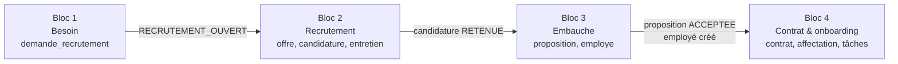

| Bloc | Entrée | Sortie | Objets principaux |
|---|---|---|---|
| 1 | Un manager a besoin de quelqu'un | Demande `RECRUTEMENT_OUVERT` | `departement`, `poste`, `demande_recrutement`, `validation` |
| 2 | Demande `RECRUTEMENT_OUVERT` | Candidature `RETENUE` | `offre_emploi`, `candidat`, `candidature`, `entretien`, `evaluation_candidat` |
| 3 | Candidature `RETENUE` | `employe` créé avec son matricule | `proposition_embauche`, `employe` |
| 4 | Employé créé | Contrat `ACTIF`, poste `OCCUPE`, onboarding `TERMINE` | `contrat`, `avenant`, `affectation`, `onboarding`, `onboarding_tache`, `document` |

### Les trois principes du cours

- **POSTE ≠ EMPLOYÉ** : un poste existe sans occupant. C'est `affectation` qui dit qui l'occupe, et quand.
- **CANDIDAT ≠ EMPLOYÉ** : l'embauche convertit un candidat en salarié. Ce sont deux tables distinctes.
- **Historiser plutôt qu'écraser** : contrats, affectations, validations sont des lignes datées.

### Principes transverses (valables pour tous les blocs)

| Principe | Mise en œuvre |
|---|---|
| Pas de suppression métier | Aucun `DELETE` sur une donnée métier, aucun `ON DELETE CASCADE`. On change un statut (`SUPPRIME`, `CLOTUREE`, `ANNULEE`, `REJETEE`…). |
| Changement de statut = ligne `historique_*` | La ligne d'historique (ancien statut, nouveau statut, qui, quand, commentaire) est écrite **dans la même méthode `@Transactional`** que le changement. Création : on trace aussi `null → statut initial`. Voir [`historique.md`](../config/historique.md). |
| Workflow centralisé | Une classe par entité à statut décide des transitions (statut × rôle → statuts suivants), sur le modèle de `DemandeWorkflow`. Refus → 422 `TRANSITION_INTERDITE`. |
| Utilisateur courant jamais dans le JSON | L'auteur (`cree_par`, `demandeur_id`, `valideur_id`, `utilisateur_id`, `fait_par`…) vient toujours de `UtilisateurCourant` (session si sécurité active, en-tête `X-Utilisateur-Id` sinon). |
| Règles dans les services | Les contrôleurs ne contiennent aucune règle. `@PreAuthorize` filtre par rôle (sécurité active seulement) ; les règles liées au rôle sont **aussi** vérifiées dans les services. |
| Erreurs en JSON | Toujours `{code, message, details}`. 400 `VALIDATION` / `REQUETE_ILLISIBLE` / `PARAMETRE_INVALIDE`, 401 `IDENTIFIANTS_INVALIDES`, 403 `ACCES_REFUSE`, 404 `RESSOURCE_INTROUVABLE`, 409 `CONTRAINTE_VIOLEE`, 422 = règle de gestion (code métier). |
| Journal d'audit (bloc 5) | Les `historique_*` disent qui a changé quel statut. En plus, depuis V14, `journal_audit` trace les **consultations** de données sensibles (dossier, salaire, contrats), les téléchargements, les modifications de dossier et de paramètres, les exports et les accès refusés. Ajout seul (déclencheur SQL). |
| Enums = valeurs SQL | Les enums Java reprennent exactement les valeurs des `CHECK` SQL, en `@Enumerated(STRING)`. |

### Rôles

Les rôles existent dans `role.code` : `MANAGER`, `RH`, `DIRECTION`, `SALARIE`, `ADMIN`, `DSI`, `PAIE`, `SERVICES_GENERAUX`. Un utilisateur a un seul rôle (`utilisateur.role_id`).

---

## Bloc 1 — Expression du besoin en personnel

**État : back fait et testé. Front à faire.** Todo : [bloc1_todo.md](bloc1_todo.md).

### Objectif

Un manager exprime un besoin : **création** d'un poste ou **remplacement** d'un salarié. La demande passe par la RH puis la Direction. Une fois validée, la RH ouvre le recrutement (entrée du bloc 2).

Informations d'une demande (cours) : poste, département, effectif, motif, budget, date souhaitée.

### Acteurs

| Rôle | Ce qu'il fait |
|---|---|
| `ADMIN`, `RH` | Gèrent le référentiel : départements (nom, budget, responsable) et postes. |
| `MANAGER` | Responsable d'un département. Crée, modifie, soumet, annule **ses** demandes. |
| `RH` | Premier niveau de validation. Ouvre le recrutement après la Direction. |
| `DIRECTION` | Second niveau de validation. |

### Workflow d'une demande de recrutement

Source : `service/DemandeWorkflow.java`. Statuts de `demande_recrutement.statut`.

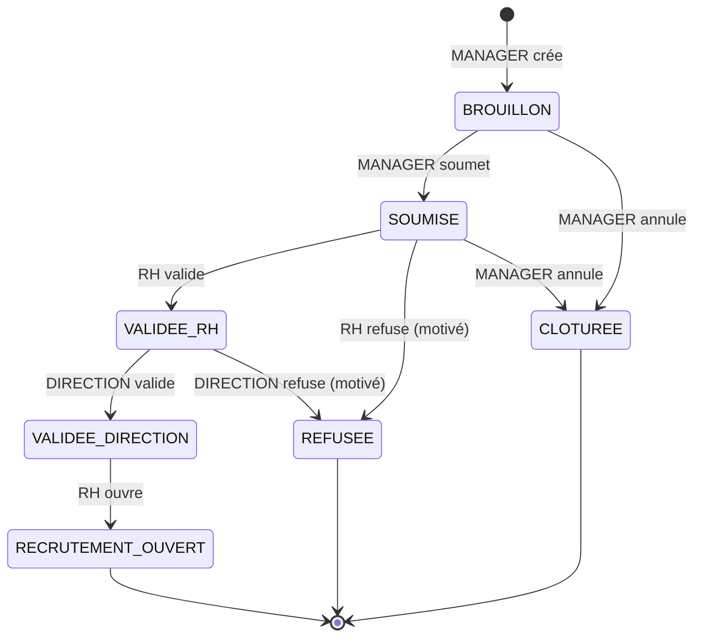

| De | Vers | Qui | Route |
|---|---|---|---|
| — | `BROUILLON` | `MANAGER` (responsable du département) | `POST /api/demandes` |
| `BROUILLON` | `SOUMISE` | `MANAGER` demandeur | `POST /api/demandes/{id}/soumettre` |
| `BROUILLON`, `SOUMISE` | `CLOTUREE` | `MANAGER` demandeur | `POST /api/demandes/{id}/annuler` |
| `SOUMISE` | `VALIDEE_RH` / `REFUSEE` | `RH` | `POST /api/demandes/{id}/validations` |
| `VALIDEE_RH` | `VALIDEE_DIRECTION` / `REFUSEE` | `DIRECTION` | `POST /api/demandes/{id}/validations` |
| `VALIDEE_DIRECTION` | `RECRUTEMENT_OUVERT` | `RH` | `POST /api/demandes/{id}/ouvrir-recrutement` |

`REFUSEE`, `CLOTUREE` et `RECRUTEMENT_OUVERT` sont finaux dans le code actuel.

Statuts d'un poste (`poste.statut`) : `VACANT` (à la création), `OCCUPE`, `SUPPRIME`. Changement manuel par `ADMIN` / `RH`.

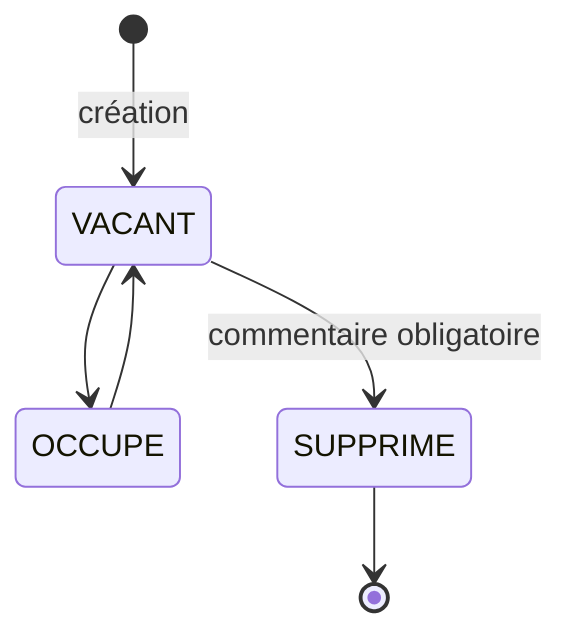

### Règles de gestion

| Règle | Code d'erreur (422) |
|---|---|
| Seul le responsable du département du poste peut faire une demande sur ce poste. | `PAS_RESPONSABLE` |
| Pas de demande sur un poste `SUPPRIME`. | `POSTE_SUPPRIME` |
| `CREATION` : pas d'employé sortant (aussi en `CHECK` SQL). `REMPLACEMENT` : employé sortant facultatif, mais doit exister (404 sinon). | `EMPLOYE_SORTANT_INTERDIT` |
| Budget demandé ≤ budget du département (comparaison simple). | `BUDGET_DEPASSE` |
| Modification seulement en `BROUILLON`, par le demandeur. | `DEMANDE_NON_MODIFIABLE`, `PAS_LE_DEMANDEUR` |
| Les règles sont revérifiées à la soumission (poste supprimé, budget baissé, responsable changé entre-temps). | — |
| Un refus doit être motivé (aussi en `CHECK` SQL sur `validation`). | `REFUS_NON_MOTIVE` |
| La Direction ne valide pas une demande sans budget (budget = 0). | `BUDGET_ABSENT` |
| Le niveau de validation (`RH` / `DIRECTION`) est déduit du rôle, jamais envoyé par le client. | `ROLE_NON_VALIDEUR` |
| Chaque décision = 1 ligne `validation` (jamais modifiée) + 1 ligne `historique_demande_recrutement`. | — |
| Transition non prévue par `DemandeWorkflow`. | `TRANSITION_INTERDITE` |
| Département : nom unique ; responsable = utilisateur actif de rôle `MANAGER`. Changement de budget ou de responsable → `historique_departement`. | `NOM_DEJA_UTILISE`, `RESPONSABLE_INVALIDE` |
| Poste : `SUPPRIME` est figé ; `OCCUPE → SUPPRIME` interdit ; suppression motivée ; même statut refusé. | `POSTE_SUPPRIME`, `POSTE_OCCUPE`, `COMMENTAIRE_OBLIGATOIRE`, `STATUT_INCHANGE` |

### Tables concernées

| Table | Rôle |
|---|---|
| `role`, `utilisateur` | Acteurs et connexion. |
| `departement` | `nom` (unique), `responsable_id`, `budget`. |
| `poste` | `intitule`, `departement_id`, `role_id`, `statut`. Un rôle regroupe plusieurs postes ; `role_id` remplace `classification` (migration V3). Une personne n'occupe qu'un poste à la fois (garanti par `affectation`, blocs 3-4). |
| `demande_recrutement` | `poste_id`, `demandeur_id`, `type` (`CREATION` / `REMPLACEMENT`), `employe_sortant_id`, `effectif`, `motif`, `budget`, `date_souhaitee`, `statut`. |
| `validation` | `demande_id`, `valideur_id`, `niveau` (`RH` / `DIRECTION`), `decision` (`VALIDEE` / `REFUSEE`), `commentaire`, `date_validation`. |
| `historique_demande_recrutement`, `historique_poste`, `historique_departement` | Traces des changements. |
| `employe` | Lu seulement (employé sortant d'un remplacement). |

### Routes API (existantes)

| Méthode | Route | Rôle | Effet |
|---|---|---|---|
| POST | `/api/auth/login` | public | Ouvre la session (sécurité active seulement). Corps `{login, motDePasse}`. |
| POST | `/api/auth/logout` | identifié | Ferme la session (204). |
| GET | `/api/moi` | identifié | Utilisateur courant et son rôle. |
| GET | `/api/departements` | identifié | Liste des départements. |
| GET | `/api/departements/{id}` | identifié | Département et ses postes. |
| POST | `/api/departements` | `ADMIN`, `RH` | Crée un département (201). |
| PUT | `/api/departements/{id}` | `ADMIN`, `RH` | Modifie ; historise budget / responsable. |
| GET | `/api/postes?departementId=&statut=` | identifié | Liste filtrable. |
| POST | `/api/postes` | `ADMIN`, `RH` | Crée un poste `VACANT` (201). |
| PATCH | `/api/postes/{id}/statut` | `ADMIN`, `RH` | Change le statut. Corps `{statut, commentaire}`. |
| POST | `/api/demandes` | `MANAGER` | Crée une demande `BROUILLON` (201). |
| PUT | `/api/demandes/{id}` | `MANAGER` | Modifie un brouillon. |
| POST | `/api/demandes/{id}/soumettre` | `MANAGER` | `BROUILLON → SOUMISE`. Corps facultatif `{commentaire}`. |
| POST | `/api/demandes/{id}/annuler` | `MANAGER` | `→ CLOTUREE`. Corps facultatif `{commentaire}`. |
| GET | `/api/demandes/mes-demandes` | identifié | Demandes de l'utilisateur courant. |
| GET | `/api/demandes/{id}` | identifié | Demande + validations + historique. |
| POST | `/api/demandes/{id}/validations` | `RH`, `DIRECTION` | Décision `{decision, commentaire}` (201). |
| POST | `/api/demandes/{id}/ouvrir-recrutement` | `RH` | `VALIDEE_DIRECTION → RECRUTEMENT_OUVERT`. |
| GET | `/api/validations/a-traiter` | `RH`, `DIRECTION` | `SOUMISE` pour la RH, `VALIDEE_RH` pour la Direction. |
| GET | `/api/demandes?statut=` | `RH`, `DIRECTION`, `ADMIN` | Toutes les demandes, filtre facultatif (tableau de bord). |
| GET | `/api/departements/{id}/historique` | identifié | Changements de budget / responsable. |
| GET | `/api/postes/{id}` | identifié | Un poste. |
| GET | `/api/postes/{id}/historique` | identifié | Changements de statut du poste. |
| GET | `/api/employes?statut=` | identifié | Employés (choix de l'employé sortant). |
| GET | `/api/utilisateurs?role=` | identifié | Comptes actifs : id, login, rôle (choix du responsable). |

### Écrans (front Vue 3, faits : voir `frontend/README.md`)

| Acteur | Écran |
|---|---|
| Tous | Connexion, en-tête avec l'utilisateur courant (`/api/moi`). |
| `ADMIN`, `RH` | Départements (liste, fiche, création, modification) ; postes (liste filtrable, création, changement de statut). |
| `MANAGER` | Formulaire de demande ; « Mes demandes » ; fiche détail (validations + historique). |
| `RH` | File de validation (`SOUMISE`) ; ouverture du recrutement (`VALIDEE_DIRECTION`). |
| `DIRECTION` | Tableau de bord : demandes `VALIDEE_RH` à décider, avec budget et motif. |

### Points ouverts

- **Annulation** : statut `CLOTUREE`, seulement depuis `BROUILLON` ou `SOUMISE`. Annuler après `VALIDEE_RH` ? À trancher.
- **Budget** : comparé au budget du département **sans déduire** les demandes en cours. Faut-il déduire les demandes `SOUMISE` … `RECRUTEMENT_OUVERT` ?
- **Employé sortant** : pas de vérification qu'il est `ACTIF`, ni qu'il occupe le poste concerné.
- **Lecture** : `GET /api/demandes/{id}` est lisible par tout utilisateur identifié. À restreindre (demandeur, RH, Direction) ?
- **Poste `OCCUPE`** : passage manuel pour l'instant. Au bloc 4, il devrait découler d'une `affectation`.
- **Clôture d'une demande pourvue** : `RECRUTEMENT_OUVERT` est final dans `DemandeWorkflow`. Le cours (bloc 3) demande de clore la demande quand l'effectif est atteint : il faudra ajouter `RECRUTEMENT_OUVERT → CLOTUREE`.
- **Divergence avec le cours** : le cours dit « chaque passage est enregistré dans Validation ». Ici, `validation` ne contient que les décisions RH / Direction ; les autres passages (soumission, annulation, ouverture) sont dans `historique_demande_recrutement`. Ensemble, les deux tables couvrent bien tout le parcours.
- CSRF désactivé avec cookie de session : acceptable pour le projet, à revoir si l'application est exposée.

---

## Bloc 2 — Recrutement

**État : tables créées dans V1, rien d'autre.** Todo : [bloc2_todo.md](bloc2_todo.md).

### Objectif

Transformer une demande validée en offre d'emploi, la publier, recevoir des candidatures, présélectionner, organiser entretiens et tests, et conserver les évaluations pour justifier la décision finale.

### Acteurs

| Rôle | Ce qu'il fait |
|---|---|
| `RH` | Crée, publie, clôture, annule les offres. Enregistre candidats et candidatures. Fait avancer les candidatures. Planifie les entretiens. Décide (`RETENUE` / `REJETEE`). |
| `MANAGER` | Participe aux entretiens (`entretien_participant`) et évalue. Consulte les candidatures de ses demandes. |
| `DIRECTION` | Peut participer à un entretien et évaluer (facultatif). |
| `SALARIE` | Candidature interne : un employé peut postuler (`candidat.employe_id`). |
| Candidat externe | N'a pas de compte : la RH saisit sa candidature (pas de portail public au MVP). |

### Workflow d'une offre (`offre_emploi.statut`)

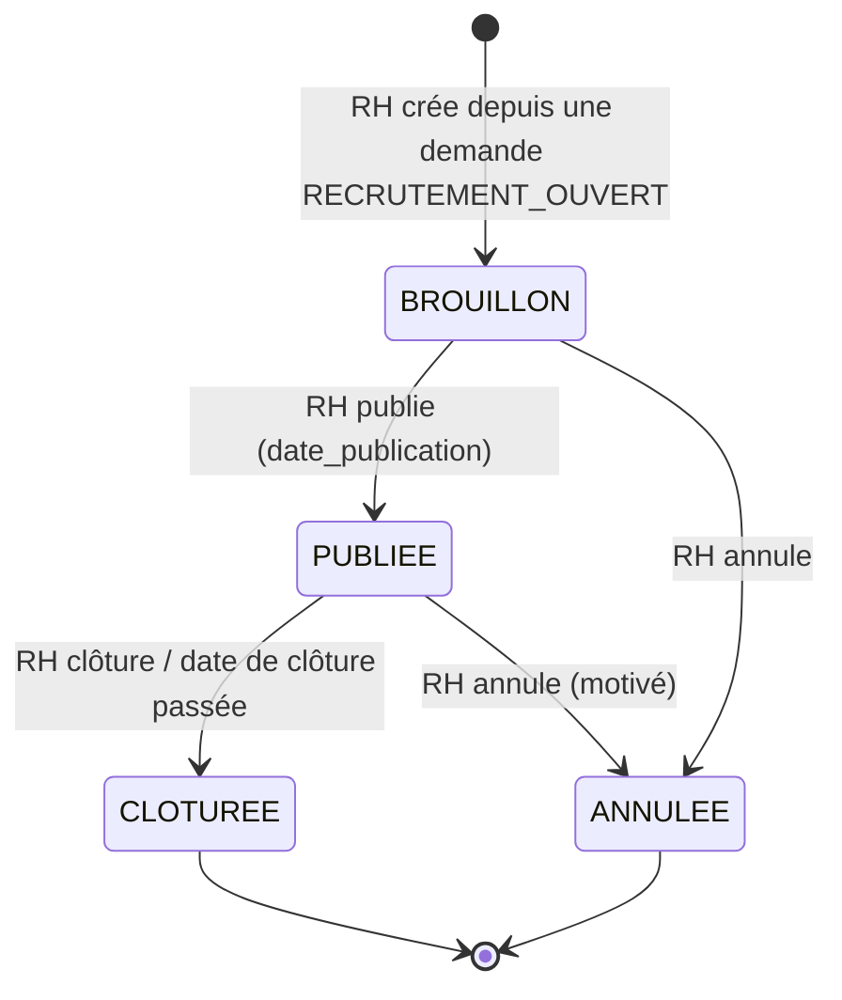

| De | Vers | Qui | Condition |
|---|---|---|---|
| — | `BROUILLON` | `RH` | Demande au statut `RECRUTEMENT_OUVERT`. |
| `BROUILLON` | `PUBLIEE` | `RH` | `titre` renseigné ; `date_publication` fixée (`CHECK` SQL). |
| `PUBLIEE` | `CLOTUREE` | `RH` | Fin de la réception des candidatures. |
| `BROUILLON`, `PUBLIEE` | `ANNULEE` | `RH` | Commentaire obligatoire (proposé). |

### Workflow d'une candidature (`candidature.statut`)

D'après le cours : `RECUE → PRESELECTIONNEE → EN_ENTRETIEN → EN_TEST → RETENUE / REJETEE (ou DESISTEMENT)`.

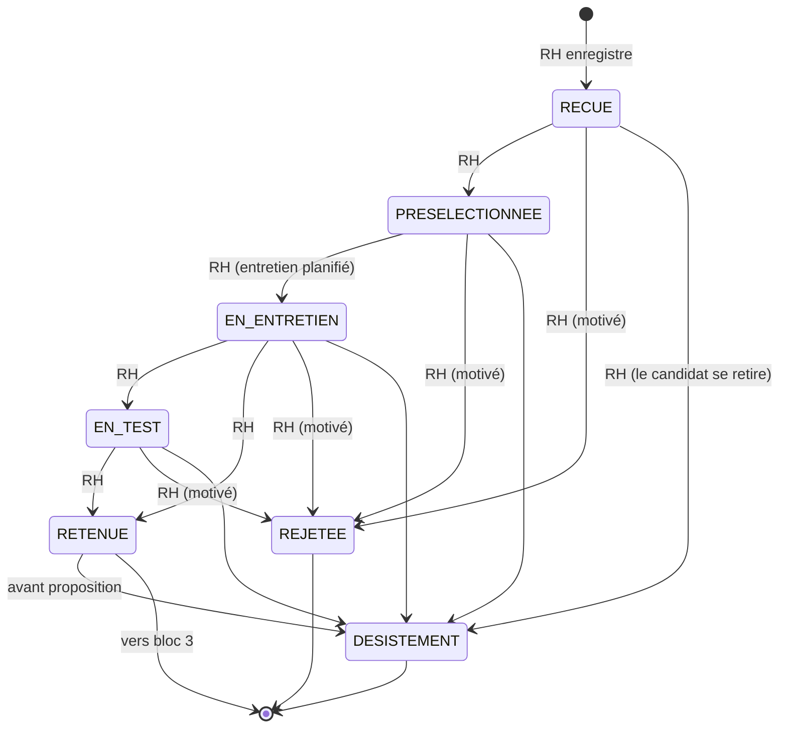

| De | Vers | Qui |
|---|---|---|
| — | `RECUE` | `RH` |
| `RECUE` | `PRESELECTIONNEE` | `RH` |
| `PRESELECTIONNEE` | `EN_ENTRETIEN` | `RH` |
| `EN_ENTRETIEN` | `EN_TEST`, `RETENUE` | `RH` |
| `EN_TEST` | `RETENUE` | `RH` |
| tout statut non final | `REJETEE` | `RH`, commentaire obligatoire (`CHECK` SQL sur `historique_candidature`) |
| tout statut non final, `RETENUE` | `DESISTEMENT` | `RH` (au nom du candidat) |

Proposé : un `CandidatureWorkflow` sur le modèle de `DemandeWorkflow`.

### Workflow d'un entretien (`entretien.statut`)

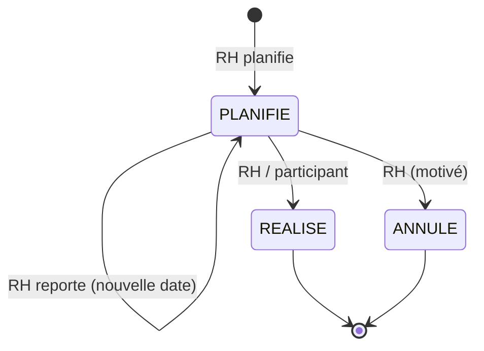

Un report garde le statut `PLANIFIE` et écrit une ligne `historique_entretien` avec `ancienne_date` / `nouvelle_date` (c'est pour cela que cette table n'a pas de `CHECK ancien ≠ nouveau`).

### Règles de gestion

- Une offre ne peut être créée que depuis une demande `RECRUTEMENT_OUVERT` (cours). Une demande peut avoir plusieurs offres (`1 → 0..N`).
- Une offre `PUBLIEE` a une `date_publication` ; `date_cloture ≥ date_publication` (`CHECK` SQL).
- On ne postule qu'à une offre `PUBLIEE`, et pas après `date_cloture` (cours).
- Un candidat ne postule qu'une fois à la même offre : `UNIQUE (candidat_id, offre_id)`. Côté service : 422 `CANDIDATURE_EXISTANTE` plutôt que 409.
- Un candidat est une personne : `candidat.email` unique. On réutilise le candidat existant s'il revient pour une autre offre.
- Candidature interne : `candidat.employe_id` renseigné, l'employé doit exister.
- Un rejet doit être motivé (`CHECK` SQL sur `historique_candidature`).
- On ne supprime jamais une candidature rejetée : on change son statut (cours).
- Un entretien se planifie sur une candidature `PRESELECTIONNEE` ou `EN_ENTRETIEN` / `EN_TEST`. Le type est `RH`, `TECHNIQUE` ou `TEST`. Planifier le premier entretien fait passer la candidature à `EN_ENTRETIEN` (proposé).
- Un participant est un `utilisateur` actif ; il ne figure qu'une fois (clé primaire composée).
- Une évaluation n'est possible que sur un entretien `REALISE`, par un participant de l'entretien (proposé). Note entre 0 et 20, avis `FAVORABLE` / `RESERVE` / `DEFAVORABLE`. Une évaluation n'est jamais modifiée.
- `RETENUE` : au moins une évaluation existe (proposé, pour « justifier la décision finale »).
- Clôturer ou annuler une offre ne touche pas automatiquement les candidatures en cours : à trancher (voir Points ouverts).
- Chaque changement de statut → `historique_offre_emploi`, `historique_candidature` ou `historique_entretien`, dans la même transaction.

### Tables concernées

| Table | Colonnes utiles |
|---|---|
| `offre_emploi` | `demande_id`, `titre`, `description`, `date_publication`, `date_cloture`, `statut`, `cree_par` |
| `candidat` | `nom`, `prenom`, `email` (unique), `telephone`, `cv_chemin`, `employe_id` |
| `candidature` | `candidat_id`, `offre_id`, `date_candidature`, `lettre`, `statut` |
| `entretien` | `candidature_id`, `date_entretien`, `type`, `lieu`, `statut`, `cree_par` |
| `entretien_participant` | `entretien_id`, `utilisateur_id` |
| `evaluation_candidat` | `entretien_id`, `evaluateur_id`, `critere`, `note`, `commentaire`, `avis` |
| `historique_offre_emploi`, `historique_candidature`, `historique_entretien` | Traces |
| `document` | CV et lettre de motivation (`type` = `CV`, `LETTRE_MOTIVATION`, `candidat_id`) |

### Routes API (prévues)

| Méthode | Route | Rôle | Effet |
|---|---|---|---|
| GET | `/api/offres?statut=&demandeId=` | identifié | Liste filtrable. |
| GET | `/api/offres/{id}` | identifié | Offre + historique. |
| POST | `/api/demandes/{id}/offres` | `RH` | Crée une offre `BROUILLON` (201). |
| PUT | `/api/offres/{id}` | `RH` | Modifie une offre `BROUILLON`. |
| POST | `/api/offres/{id}/publier` | `RH` | `BROUILLON → PUBLIEE`. |
| POST | `/api/offres/{id}/cloturer` | `RH` | `PUBLIEE → CLOTUREE`. |
| POST | `/api/offres/{id}/annuler` | `RH` | `→ ANNULEE`. Corps `{commentaire}`. |
| GET | `/api/candidats?email=` | `RH` | Recherche d'un candidat. |
| POST | `/api/candidats` | `RH` | Crée un candidat (201). |
| GET | `/api/candidats/{id}` | `RH` | Candidat + ses candidatures. |
| POST | `/api/offres/{id}/candidatures` | `RH` | Candidature `RECUE` `{candidatId, lettre}` (201). |
| GET | `/api/offres/{id}/candidatures?statut=` | `RH`, `MANAGER` demandeur | Candidatures d'une offre. |
| GET | `/api/candidatures/{id}` | `RH`, `MANAGER` demandeur | Candidature + entretiens + évaluations + historique. |
| POST | `/api/candidatures/{id}/statut` | `RH` | Change le statut `{statut, commentaire}` (via le workflow). |
| POST | `/api/candidatures/{id}/entretiens` | `RH` | Planifie `{dateEntretien, type, lieu, participantIds}` (201). |
| POST | `/api/entretiens/{id}/reporter` | `RH` | Nouvelle date `{dateEntretien, commentaire}`. |
| POST | `/api/entretiens/{id}/realiser` | `RH`, participant | `PLANIFIE → REALISE`. |
| POST | `/api/entretiens/{id}/annuler` | `RH` | `PLANIFIE → ANNULE`. |
| POST | `/api/entretiens/{id}/evaluations` | participant | Évaluation `{critere, note, commentaire, avis}` (201). |
| GET | `/api/entretiens/mes-entretiens` | identifié | Entretiens où l'utilisateur courant participe. |

### Points ouverts

- **Candidat sans compte** : le cours ne prévoit pas de portail candidat. Proposé : saisie par la RH uniquement.
- **Clôture automatique** de l'offre à `date_cloture` : tâche planifiée, ou simple contrôle au moment de postuler ? Proposé : contrôle au moment de postuler, clôture manuelle.
- **Effet de l'annulation d'une offre** sur les candidatures en cours (les passer à `REJETEE` avec un motif ?).
- **CV** : `candidat.cv_chemin` et `document` (type `CV`) font doublon. Choisir l'un des deux.
- **`EN_TEST`** : le cours le place après `EN_ENTRETIEN`, mais `entretien.type` accepte aussi `TEST`. Faut-il passer en `EN_TEST` quand un entretien de type `TEST` est planifié ?
- **Pas de statut d'évaluation ni d'historique** : une évaluation est figée. Correction d'une erreur de saisie : nouvelle ligne ?
- **Droits du manager** : voir seulement les candidatures des offres issues de ses demandes.
- **Données personnelles** (cours) : durée de conservation des candidatures non retenues, non modélisée.

---

## Bloc 3 — Embauche

**État : tables créées dans V1 (`employe` lu au bloc 1), rien d'autre.** Todo : [bloc3_todo.md](bloc3_todo.md).

### Objectif

Le candidat retenu reçoit une proposition d'embauche. S'il accepte, on crée son dossier salarié (`employe`) et son matricule. Puis on enchaîne vers le contrat, l'affectation et l'onboarding (bloc 4).

L'embauche est un **événement de conversion** : candidature `RETENUE` + proposition `ACCEPTEE` → employé.

### Acteurs

| Rôle | Ce qu'il fait |
|---|---|
| `RH` | Crée la proposition, enregistre la réponse du candidat, déclenche l'embauche. |
| `DIRECTION` | Peut être consultée sur le salaire proposé (voir Points ouverts). |
| `MANAGER` | Consulte la proposition pour son poste. |
| Candidat | Accepte ou refuse (la RH saisit la réponse). |

### Workflow d'une proposition (`proposition_embauche.statut`)

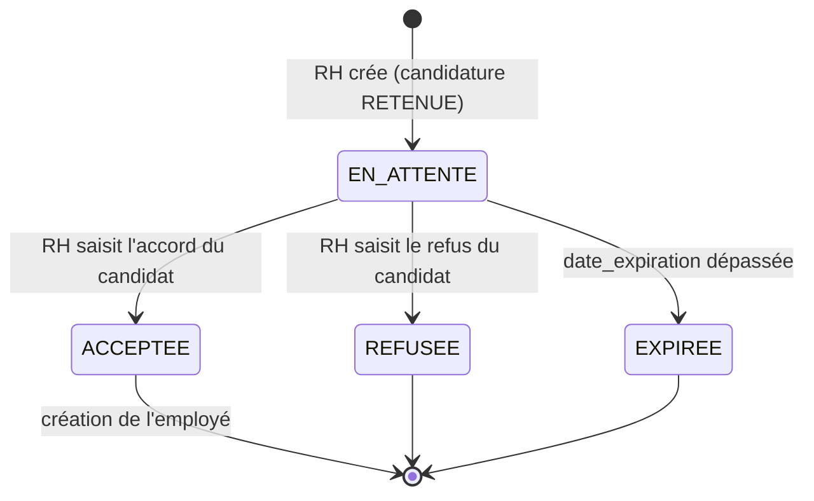

| De | Vers | Qui | Effet |
|---|---|---|---|
| — | `EN_ATTENTE` | `RH` | Candidature `RETENUE` obligatoire. |
| `EN_ATTENTE` | `ACCEPTEE` | `RH` | Crée l'`employe` dans la même transaction (ou en étape suivante, voir Points ouverts). |
| `EN_ATTENTE` | `REFUSEE` | `RH` | Commentaire conseillé. La candidature peut passer en `DESISTEMENT`. |
| `EN_ATTENTE` | `EXPIREE` | `RH` ou système | `date_expiration` < aujourd'hui. |

Statuts de l'employé (`employe.statut`) : `ACTIF` à la création. `SUSPENDU` et `SORTI` relèvent de la suite du cours (vie du salarié, rupture). Chaque changement → `historique_employe`.

### Enchaînement de l'embauche (cours)

1. Candidature `RETENUE` → `proposition_embauche` (salaire, date de début, type de contrat).
2. Proposition `ACCEPTEE` (ou `REFUSEE` / `EXPIREE`).
3. Si acceptée : création de l'`employe` avec un matricule unique.
4. Création du `contrat` puis de l'`affectation` au poste ; le poste passe de `VACANT` à `OCCUPE` (bloc 4).
5. Clôture de l'offre / de la demande si l'effectif est atteint.

### Règles de gestion

- Une proposition ne se crée que sur une candidature `RETENUE`.
- Une seule proposition `EN_ATTENTE` ou `ACCEPTEE` par candidature (proposé ; la base ne l'impose pas).
- `salaire > 0`, `type_contrat` ∈ `CDD`, `CDI`, `STAGE`, `INTERIM` (`CHECK` SQL). `date_expiration` ≥ date du jour à la création (proposé).
- Pas d'employé sans proposition acceptée (cours). Exception : employés repris avant le SIRH (FK nullables).
- Le matricule est **généré par le système** et **jamais réutilisé** (cours ; `matricule` unique). Proposé : `EMP-<année>-<séquence>`, séquence PostgreSQL dédiée ou calcul à partir du max.
- L'employé reprend les données du candidat (`nom`, `prenom`, `email`, `telephone`) et garde le lien `candidat_id`, `proposition_id`. `date_embauche` = `date_debut` de la proposition.
- `employe.email` est unique : contrôle avant création (422 plutôt que 409).
- **Mobilité interne** : si `candidat.employe_id` est renseigné, on ne crée **pas** de nouvel employé ; il garde son matricule (cours). La suite passe par une nouvelle `affectation` (`MUTATION` / `PROMOTION`) au bloc 4.
- Création du compte de connexion (`utilisateur` de rôle `SALARIE`, lié par `employe.utilisateur_id`) : faite à l'onboarding (tâche DSI), pas ici.
- Quand le nombre d'embauches atteint `demande_recrutement.effectif` : clôturer l'offre (`CLOTUREE`) et la demande (`CLOTUREE`). Les autres candidatures non finales passent en `REJETEE` avec un motif (proposé).
- Chaque changement → `historique_proposition_embauche`, `historique_employe` (création : `null → ACTIF`), dans la même transaction.

### Tables concernées

| Table | Colonnes utiles |
|---|---|
| `proposition_embauche` | `candidature_id`, `salaire`, `date_debut`, `type_contrat`, `date_expiration`, `statut`, `cree_par` |
| `employe` | `matricule`, `candidat_id`, `proposition_id`, `utilisateur_id`, `nom`, `prenom`, `email`, `telephone`, `date_naissance`, `date_embauche`, `statut` |
| `historique_proposition_embauche`, `historique_employe` | Traces |
| `candidature`, `candidat`, `offre_emploi`, `demande_recrutement` | Lus / mis à jour (clôture) |

### Routes API (prévues)

| Méthode | Route | Rôle | Effet |
|---|---|---|---|
| POST | `/api/candidatures/{id}/propositions` | `RH` | Crée une proposition `EN_ATTENTE` (201). |
| GET | `/api/propositions?statut=` | `RH` | Liste. |
| GET | `/api/propositions/{id}` | `RH`, `MANAGER` concerné | Proposition + historique. |
| POST | `/api/propositions/{id}/accepter` | `RH` | `→ ACCEPTEE` + création de l'employé ; renvoie l'employé. |
| POST | `/api/propositions/{id}/refuser` | `RH` | `→ REFUSEE`. Corps `{commentaire}`. |
| POST | `/api/propositions/{id}/expirer` | `RH` | `→ EXPIREE`. |
| GET | `/api/employes?statut=&departementId=` | `RH`, `DIRECTION` | Liste du personnel. |
| GET | `/api/employes/{id}` | `RH`, l'employé lui-même | Dossier salarié (contrats, affectations, onboarding au bloc 4). |

### Points ouverts

- **`RECRUTEMENT_OUVERT` est final** dans `DemandeWorkflow` : ajouter `RECRUTEMENT_OUVERT → CLOTUREE` (rôle `RH` ou système) pour clore la demande pourvue.
- **Validation du salaire** : le cours ne dit pas qui valide la proposition. Pas de colonne pour cela dans `proposition_embauche`. Proposé : RH seule.
- **Salaire ≤ budget de la demande ?** Le cours ne le dit pas. Proposé : avertissement, pas un blocage.
- **Expiration** : automatique (tâche planifiée) ou à la lecture ? Proposé : action RH + contrôle à l'acceptation (refus d'accepter une proposition expirée).
- **Création de l'employé** : dans la même transaction que l'acceptation (proposé), ou action séparée « embaucher » ?
- **Cours** : « Créer le contrat, le poste et l'affectation ». Le poste existe déjà depuis le bloc 1 ; on ne le recrée pas, on l'affecte. Le contrat et l'affectation sont traités au bloc 4.
- **Deux chemins vers la proposition** : `employe.proposition_id` et `onboarding.proposition_id` doivent désigner la même proposition ; la base ne le vérifie pas (contrôle service).
- **Mobilité interne** : `employe.proposition_id` est unique et garde la première embauche. La proposition interne n'est donc reliée qu'à l'onboarding et à l'affectation. Onboarding obligatoire pour une mobilité ?
- **`date_naissance`** : absente de `candidat`, elle est à saisir lors de l'embauche.

---

## Bloc 4 — Contrat & Onboarding

**État : tables créées dans V1, rien d'autre.** Todo : [bloc4_todo.md](bloc4_todo.md).

### Objectif

- Gérer les **contrats successifs** d'un salarié (CDD, renouvellement, CDI…) sans écraser l'historique : pas de `employe.type_contrat`.
- Modifier un contrat par **avenant** daté et validé.
- **Affecter** l'employé à un poste sur une période (retrace les mutations).
- Intégrer le salarié par une **checklist** d'onboarding : contrat signé, badge, compte, matériel, formation, inscription paie.
- Stocker les **pièces** (métadonnées en base, fichier en GED).

### Acteurs

| Rôle | Ce qu'il fait |
|---|---|
| `RH` | Crée et active les contrats, avenants, affectations. Lance l'onboarding. Fait signer le contrat. Gère le modèle de checklist (avec `ADMIN`). |
| `SERVICES_GENERAUX` | Crée le badge d'accès. |
| `DSI` | Crée le compte informatique (et l'`utilisateur` `SALARIE`), fournit le matériel. |
| `MANAGER` | Planifie la formation d'accueil. |
| `PAIE` | Inscrit le salarié en paie. |
| `SALARIE` | Consulte son dossier, dépose ses pièces (pièce d'identité, RIB, diplômes). |
| `ADMIN` | Gère `modele_tache_onboarding`. |

Checklist type du cours (à mettre dans `modele_tache_onboarding`) :

| Tâche | `role_responsable_id` |
|---|---|
| Faire signer le contrat | `RH` |
| Créer le badge d'accès | `SERVICES_GENERAUX` |
| Créer le compte informatique | `DSI` |
| Fournir le matériel (PC, téléphone) | `DSI` |
| Planifier la formation d'accueil | `MANAGER` |
| Inscrire le salarié en paie | `PAIE` |

### Workflow d'un contrat (`contrat.statut`)

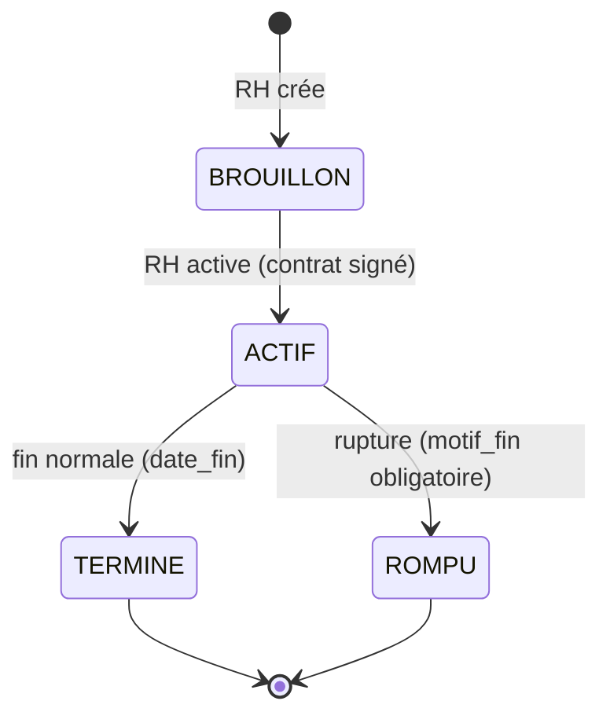

| De | Vers | Qui | Condition |
|---|---|---|---|
| — | `BROUILLON` | `RH` | Employé existant. |
| `BROUILLON` | `ACTIF` | `RH` | Contrat signé (document `CONTRAT_SIGNE`, proposé). Pas d'autre contrat `ACTIF` pour l'employé. |
| `ACTIF` | `TERMINE` | `RH` | Fin prévue atteinte, ou remplacé par un renouvellement / un CDI. Un CDI terminé reçoit une `date_fin`. |
| `ACTIF` | `ROMPU` | `RH` | `motif_fin` obligatoire (`CHECK` SQL), `date_fin` renseignée. |

Renouvellement : nouveau contrat avec `contrat_precedent_id` = l'ancien ; l'ancien passe `TERMINE`.

### Workflow de l'onboarding

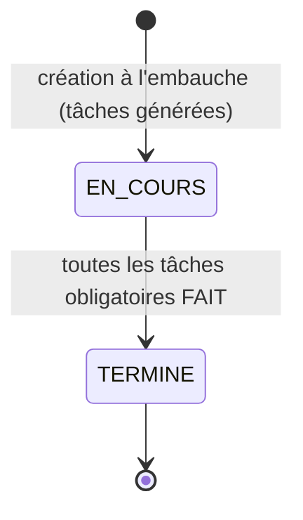

Tâche (`onboarding_tache.statut`) :

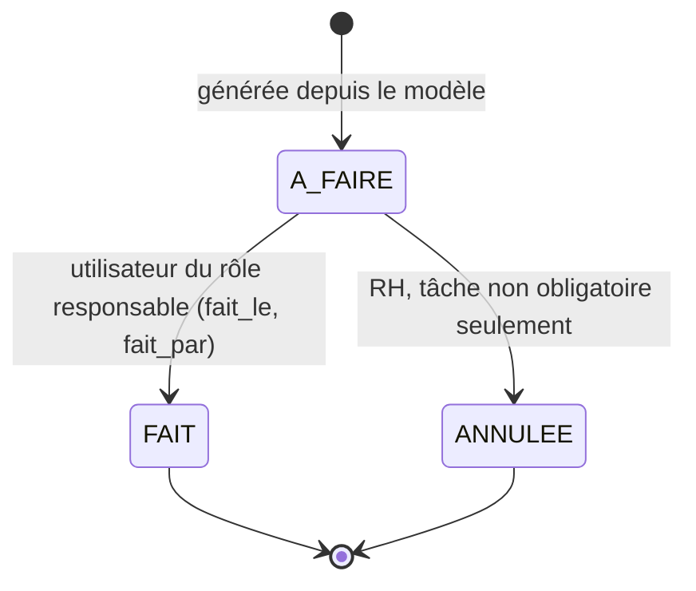

| Objet | De | Vers | Qui |
|---|---|---|---|
| `onboarding` | — | `EN_COURS` | `RH` (ou automatique à l'embauche) |
| `onboarding` | `EN_COURS` | `TERMINE` | automatique dès que toutes les tâches obligatoires sont `FAIT` ; `date_fin` renseignée |
| `onboarding_tache` | `A_FAIRE` | `FAIT` | utilisateur du rôle `role_responsable_id` (ou `responsable_id` s'il est désigné) ; `fait_le` / `fait_par` |
| `onboarding_tache` | `A_FAIRE` | `ANNULEE` | `RH` ; interdit si `obligatoire` (`CHECK` SQL) |

### Règles de gestion

**Contrats et avenants**

- 1 employé → N contrats successifs. Au plus un contrat `ACTIF` à la fois par employé (proposé ; la base ne l'impose pas).
- Le premier contrat reprend `type_contrat`, `salaire`, `date_debut` de la proposition acceptée.
- `reference` unique, générée (proposé : `C-<année>-<séquence>`, comme `C-001` dans le cours).
- `CDD` → `date_fin` obligatoire. `CDI` → pas de `date_fin` tant qu'il n'est ni `TERMINE` ni `ROMPU`. `date_fin ≥ date_debut`. `ROMPU` → `motif_fin` (tous en `CHECK` SQL).
- On ne modifie jamais un contrat actif : toute modification (salaire…) passe par un `avenant` daté, avec `valide_par`. `ancien_salaire` = salaire courant. Le contrat porte le salaire initial ; le salaire courant = dernier avenant à `date_effet` passée (à trancher, voir Points ouverts).
- Chaque changement de statut → `historique_contrat`.

**Affectations**

- Une affectation lie employé × poste × période, avec `motif` `EMBAUCHE`, `MUTATION` ou `PROMOTION`.
- À l'embauche : affectation `EMBAUCHE` au poste de la demande d'origine, liée au contrat. Le poste doit être `VACANT` ; il passe `OCCUPE` (ligne `historique_poste`).
- Mutation / promotion : on ferme l'affectation en cours (`date_fin`) et on en ouvre une nouvelle. L'ancien poste repasse `VACANT`.
- Une seule affectation ouverte (`date_fin` nulle) par employé et par poste (proposé).
- Pas de table `historique_affectation` : l'affectation est elle-même une ligne datée.

**Onboarding et documents**

- Un onboarding par embauche (`onboarding.proposition_id` unique). Créé automatiquement à l'acceptation (cours).
- Les tâches sont générées depuis `modele_tache_onboarding` actifs (`actif = true`), dans l'ordre `ordre`, en recopiant `libelle`, `role_responsable_id`, `obligatoire`. `echeance` proposée = `date_debut` de l'onboarding.
- Une tâche `FAIT` a `fait_le` et `fait_par` (`CHECK` SQL) ; `fait_par` = utilisateur courant. Pas d'historique des tâches : ces deux colonnes suffisent.
- Seul un utilisateur du rôle responsable (ou la RH) peut marquer une tâche faite.
- L'onboarding est `TERMINE` quand toutes les tâches obligatoires sont faites (cours) ; `date_fin` obligatoire (`CHECK` SQL).
- La tâche « Créer le compte informatique » crée l'`utilisateur` `SALARIE` et renseigne `employe.utilisateur_id`.
- Un `document` se rattache à au moins un objet (`employe_id`, `contrat_id`, `onboarding_tache_id`, `candidat_id`). Types : `CV`, `LETTRE_MOTIVATION`, `CONTRAT_SIGNE`, `PIECE_IDENTITE`, `RIB`, `DIPLOME`, `AUTRE`. Le fichier est en GED (`chemin_ged`), la base ne garde que les métadonnées.
- Un document n'est jamais supprimé.

### Tables concernées

| Table | Colonnes utiles |
|---|---|
| `contrat` | `reference`, `employe_id`, `contrat_precedent_id`, `type`, `date_debut`, `date_fin`, `salaire`, `statut`, `motif_fin` |
| `avenant` | `contrat_id`, `date_effet`, `objet`, `ancien_salaire`, `nouveau_salaire`, `motif`, `valide_par` |
| `affectation` | `employe_id`, `poste_id`, `contrat_id`, `date_debut`, `date_fin`, `motif` |
| `modele_tache_onboarding` | `libelle`, `role_responsable_id`, `obligatoire`, `ordre`, `actif` |
| `onboarding` | `employe_id`, `proposition_id`, `date_debut`, `date_fin`, `statut` |
| `onboarding_tache` | `onboarding_id`, `modele_id`, `libelle`, `role_responsable_id`, `responsable_id`, `echeance`, `obligatoire`, `statut`, `fait_le`, `fait_par` |
| `document` | `type`, `nom_fichier`, `chemin_ged`, rattachements, `depose_par`, `depose_le` |
| `historique_contrat`, `historique_poste`, `historique_employe` | Traces |

### Routes API (prévues)

| Méthode | Route | Rôle | Effet |
|---|---|---|---|
| GET | `/api/employes/{id}/contrats` | `RH`, l'employé | Contrats successifs (chaîne `contrat_precedent_id`). |
| POST | `/api/employes/{id}/contrats` | `RH` | Crée un contrat `BROUILLON` (201). Option `contratPrecedentId` pour un renouvellement. |
| GET | `/api/contrats/{id}` | `RH`, l'employé | Contrat + avenants + historique. |
| POST | `/api/contrats/{id}/activer` | `RH` | `BROUILLON → ACTIF`. |
| POST | `/api/contrats/{id}/terminer` | `RH` | `ACTIF → TERMINE` `{dateFin, commentaire}`. |
| POST | `/api/contrats/{id}/rompre` | `RH` | `ACTIF → ROMPU` `{dateFin, motifFin}`. |
| POST | `/api/contrats/{id}/avenants` | `RH` | Crée un avenant (201) ; `valide_par` = utilisateur courant. |
| GET | `/api/employes/{id}/affectations` | `RH`, `MANAGER` | Historique des postes. |
| POST | `/api/employes/{id}/affectations` | `RH` | Nouvelle affectation `{posteId, contratId, dateDebut, motif}` ; ferme la précédente. |
| GET | `/api/postes/{id}/affectations` | `RH`, `MANAGER` | Historique des occupants du poste. |
| GET | `/api/modeles-taches` | `RH`, `ADMIN` | Checklist type. |
| POST / PUT | `/api/modeles-taches`, `/api/modeles-taches/{id}` | `ADMIN`, `RH` | Gère le modèle (désactivation par `actif = false`, pas de suppression). |
| POST | `/api/propositions/{id}/onboarding` | `RH` | Crée l'onboarding et ses tâches (si non automatique). |
| GET | `/api/onboardings?statut=` | `RH` | Suivi des intégrations. |
| GET | `/api/onboardings/{id}` | `RH`, `MANAGER`, l'employé | Onboarding + tâches + avancement. |
| GET | `/api/onboarding-taches/a-faire` | identifié | Tâches `A_FAIRE` du rôle de l'utilisateur courant (ou qui lui sont assignées). |
| POST | `/api/onboarding-taches/{id}/faire` | rôle responsable, `RH` | `A_FAIRE → FAIT`. |
| POST | `/api/onboarding-taches/{id}/annuler` | `RH` | `A_FAIRE → ANNULEE` (non obligatoire). |
| PATCH | `/api/onboarding-taches/{id}/responsable` | `RH` | Désigne `responsable_id`. |
| POST | `/api/documents` | identifié | Dépôt (multipart) avec rattachement(s) ; `depose_par` = utilisateur courant. |
| GET | `/api/documents?employeId=&contratId=&tacheId=&candidatId=` | selon droits | Liste des pièces. |
| GET | `/api/documents/{id}/fichier` | selon droits | Téléchargement. |

### Points ouverts

- **Pas d'historique pour `onboarding` ni `affectation`** : choix assumé (deux statuts seulement / lignes datées). À confirmer.
- **Salaire courant** : stocké dans `contrat.salaire` (jamais modifié) + avenants, ou mis à jour par l'avenant ? Le cours dit de ne pas écraser : proposé, ne pas modifier `contrat.salaire` et calculer le salaire courant.
- **Avenant sans statut** : `valide_par` est `NOT NULL`, donc un avenant est créé déjà validé. Pas de circuit de validation (Direction ?).
- **« Contrat en cours »** : le cours le définit par la période (date du jour entre `date_debut` et `date_fin`). Le schéma a un `statut`. Proposé : `ACTIF` + contrôle de cohérence avec les dates. Passage automatique `ACTIF → TERMINE` à `date_fin` ? (tâche planifiée ou action RH).
- **Contrat signé** : pas de statut `SIGNE`. Proposé : `BROUILLON → ACTIF` exige un document `CONTRAT_SIGNE` (ou la tâche « Faire signer le contrat » `FAIT`).
- **Plusieurs contrats actifs** (ex. CDD qui chevauche un CDI) : interdits par service, pas par la base.
- **Stockage GED** : dossier local, MinIO… à choisir. `chemin_ged` reste un chemin opaque.
- **Notifications** (cours : « tâche d'onboarding assignée ») : non modélisées. Hors MVP ou simple e-mail ?
- **Responsable MANAGER** de la tâche « formation d'accueil » : quel manager ? Proposé : le responsable du département du poste (`departement.responsable_id`), recopié dans `responsable_id`.
- **Fin d'onboarding** : faut-il aussi attendre l'activation du contrat ?
- **Divergence avec le cours** : le cours cite un « journal d'audit » dans le MVP et l'architecture (« Audit & logs »). Le projet l'a retiré volontairement : les tables `historique_*`, `cree_le` / `cree_par`, `validation` et `fait_le` / `fait_par` couvrent le « qui a fait quoi ». La journalisation des **consultations** de données sensibles (cours, section données personnelles) n'est donc pas couverte.

---

## Bloc 5 — Dossier administratif du salarié

**État : fait (08/11/2026, V14).** Todo : [bloc5_todo.md](bloc5_todo.md). Source : diapo [`bloc5.jpg`](../cours/bloc5.jpg).

### Objectif

Centraliser identité, coordonnées, documents et situation professionnelle ; conserver contrats, affectations, salaire et carrière ; gérer la validité des pièces ; confidentialité, habilitations et **journal d'audit**. Le dossier devient le référentiel des blocs 6 et 7 (statut, contrat actif, département).

### Ce qui a été ajouté

| Besoin du cours | Réponse |
|---|---|
| Identité, coordonnées | `employe` : sexe, CIN (unique), délivrance, adresse, ville, situation familiale, enfants, contact d'urgence, date et motif de sortie. **Toutes facultatives.** |
| Modifier sans écraser | `PUT /api/employes/{id}` (RH) : une ligne `historique_modification_employe` **par champ** (avant, après, motif, qui, quand). Matricule et date d'embauche non modifiables. |
| Situation professionnelle | Calculée : poste et département de l'affectation en cours, contrat actif, fin de période d'essai, salaire courant, ancienneté. |
| Carrière | Frise **calculée** (aucune table) : embauche, contrats, renouvellements, avenants, affectations, suspensions, sortie. |
| Statut du salarié | `EmployeWorkflow` : `ACTIF → SUSPENDU / SORTI`, `SUSPENDU → ACTIF / SORTI`, `SORTI` final (RH). |
| Validité des pièces | `document` : délivrance, expiration, numéro, `remplace_par_id`. État calculé : VALIDE, EXPIRE_BIENTOT, EXPIRE, REMPLACE. Liste « pièces à renouveler ». |
| Dossier complet | Pièces obligatoires : pièce d'identité, contrat signé, RIB. |
| Confidentialité | `HabilitationsDossier` (tableau ci-dessous) ; salaire et données personnelles mis à `null` pour qui n'y a pas droit. |
| Journal d'audit | `journal_audit` + `JournalAuditService` ; lecture par l'Admin et la Direction. |

### Habilitations (D3 à D5)

| Rôle | Identité | Données personnelles | Situation pro | Salaire, contrats | Pièces | Modifier |
|---|---|---|---|---|---|---|
| RH | oui | oui | oui | oui | toutes | oui |
| DIRECTION, ADMIN | oui | oui | oui | oui | toutes | non |
| PAIE | oui | oui | oui | oui | RIB seulement | non |
| MANAGER (son équipe) | oui | non | oui | non | aucune | non |
| Autre, ou manager hors équipe | 403 `ACCES_REFUSE`, tracé `ACCES_REFUSE` dans le journal | | | | | |

« Équipe d'un manager » (`EquipeManager`) : salariés dont l'affectation **en cours** est sur un poste d'un département dont il est `responsable_id`.

### Contrôle strict ou souple (mode démo)

`sirh.dossier.controles-stricts` (= `sirh.securite.active` par défaut, `SIRH_CONTROLES_STRICTS` pour forcer). En mode démo, **ne bloquent pas** : format de la CIN (12 chiffres), âge ≥ 18 ans, format des téléphones, date d'expiration obligatoire (certificat médical, permis, titre de séjour). S'appliquent toujours : unicité CIN et e-mail, naissance avant l'embauche, dossier SORTI non modifiable.

### Sortie (D8)

Motif obligatoire ; refusée avec un contrat ACTIF (`CONTRAT_ACTIF_EXISTANT`) ; ferme l'affectation (date de fin = date de sortie), poste → VACANT (historisé) ; puis `SuiteSortieSalarie` : planning fermé (bloc 6), demandes de congé en cours annulées et congés futurs validés annulés avec recrédit (bloc 7).

### Journal d'audit (D1)

| Action | Quand |
|---|---|
| `CONSULTATION` | `GET /api/employes/{id}`, liste et fiche des contrats (salaire) |
| `TELECHARGEMENT` | fichier d'une pièce, PDF d'un contrat |
| `MODIFICATION` | identité, statut, dépôt de pièce, paramètre RH |
| `EXPORT` | variables de paie en CSV |
| `ACCES_REFUSE` | dossier refusé (manager d'une autre équipe…) |

Consultation, téléchargement, export, refus : transaction à part (`REQUIRES_NEW`), pour être écrits même en lecture seule ou en cas d'erreur. Modification : dans la transaction de la modification. Un déclencheur SQL refuse UPDATE et DELETE.

---

## Bloc 6 — Temps de travail et pointage

**État : fait (08/11/2026, V15).** Todo : [bloc6_todo.md](bloc6_todo.md). Source : diapo [`bloc6.jpg`](../cours/bloc6.jpg).

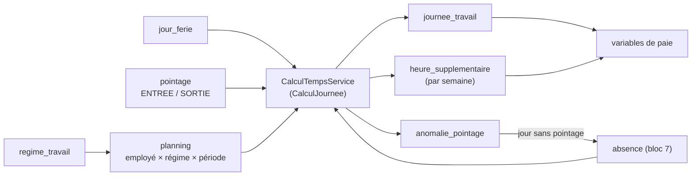

### Décisions

| # | Décision |
|---|---|
| D1 | Un pointage = un passage ENTREE ou SORTIE ; la journée est calculée. |
| D2 | Saisie RH (tous) et manager (son équipe) ; import CSV par la RH. |
| D3 | Jamais modifié ni supprimé : annulé (motif) et remplacé par un pointage CORRECTION. |
| D4 | **Confirmé** : durée légale, taux et palier des HS sont des **paramètres modifiables par la RH** (`parametre`, historisés). Base : temps prévu par le planning ; un régime ne dépasse ni la durée légale ni les heures du contrat. HS = travaillé − prévu de la semaine ; férié puis dimanche à leur taux, puis 8 h au 1er taux, le reste au 2e. Taux recopiés au calcul. |
| D5 | HS à valider par le manager de l'équipe (ou la RH) ; refus motivé ; seules les VALIDEE vont en paie. |
| D6 | **Confirmé** : tolérance par régime, modifiable par la RH ; valeur proposée = paramètre. Au-delà, retard compté en entier. |
| D7 | Arrondi : paramètre (1 = à la minute). |
| D8 | Mois OUVERTE → CLOTUREE (RH), final ; refusée s'il reste anomalies ouvertes, HS à valider, absences à justifier. |
| D9 | Calcul stocké dans `journee_travail`, recalculé à chaque écriture. |
| D10 | Jour prévu passé sans pointage → anomalie transmise aux absences (absence INJUSTIFIEE « à justifier »). |

### Calcul d'une journée (`CalculJournee`, sans base)

Prévu = fin − début − pause un jour travaillé (0 repos, férié, absence complète ; moitié pour une demi-journée). Paires ENTREE→SORTIE ; deux pointages du même sens à < 2 min : DOUBLON ; paire incomplète : SORTIE_MANQUANTE / ENTREE_MANQUANTE. Pause pointée = sortie → entrée suivante ; la pause manquante est déduite si plus d'une demi-journée travaillée. Retard et départ anticipé hors tolérance. Pointage un jour non travaillé : anomalie. Statut : CONGE, ABSENCE, FERIE, REPOS, NORMALE, ou ANOMALIE s'il reste une anomalie ouverte. Un salarié suspendu (d'après l'historique de son statut) ou sorti n'a rien de prévu.

### Paramètres RH (V15)

| Code | Défaut | Domaine |
|---|---|---|
| `ALERTE_DOCUMENT_JOURS` | 30 jours | dossier |
| `DUREE_LEGALE_HEBDO` | 40 h | temps |
| `HS_SEUIL_PALIER1` | 8 h | temps |
| `TAUX_HS_PALIER1` / `PALIER2` / `DIMANCHE` / `FERIE` | 130 / 150 / 140 / 150 % | temps |
| `TOLERANCE_RETARD_MINUTES` | 10 min | temps |
| `ARRONDI_POINTAGE_MINUTES` | 1 min | temps |
| `ACQUISITION_CONGE_MENSUELLE` | 2,5 j | congés |
| `PLAFOND_CONGE_PAYE` | 90 j | congés |
| `DELAI_JUSTIFICATIF_HEURES` | 48 h | congés |

Valeurs à vérifier dans le Code du travail malgache ; elles se règlent sans toucher au code.

### Workflows

- Anomalie : `OUVERTE → JUSTIFIEE | IGNOREE` (RH, manager, motivé) ; par le calcul : `OUVERTE ↔ CORRIGEE`, `OUVERTE → TRANSFEREE`.
- Heures sup. : `A_VALIDER → VALIDEE | REFUSEE` (manager, RH) ; le recalcul remet `A_VALIDER` si les minutes changent, `ANNULEE` s'il n'y en a plus.
- Mois : `OUVERTE → CLOTUREE` (RH).

---

## Bloc 7 — Congés et absences

**État : fait (08/11/2026, V16).** Todo : [bloc7_todo.md](bloc7_todo.md). Source : diapo [`bloc7.jpg`](../cours/bloc7.jpg). Objets du cours : `TypeConge`, `DroitConge`, `SoldeConge`, `DemandeConge`, `Absence`.

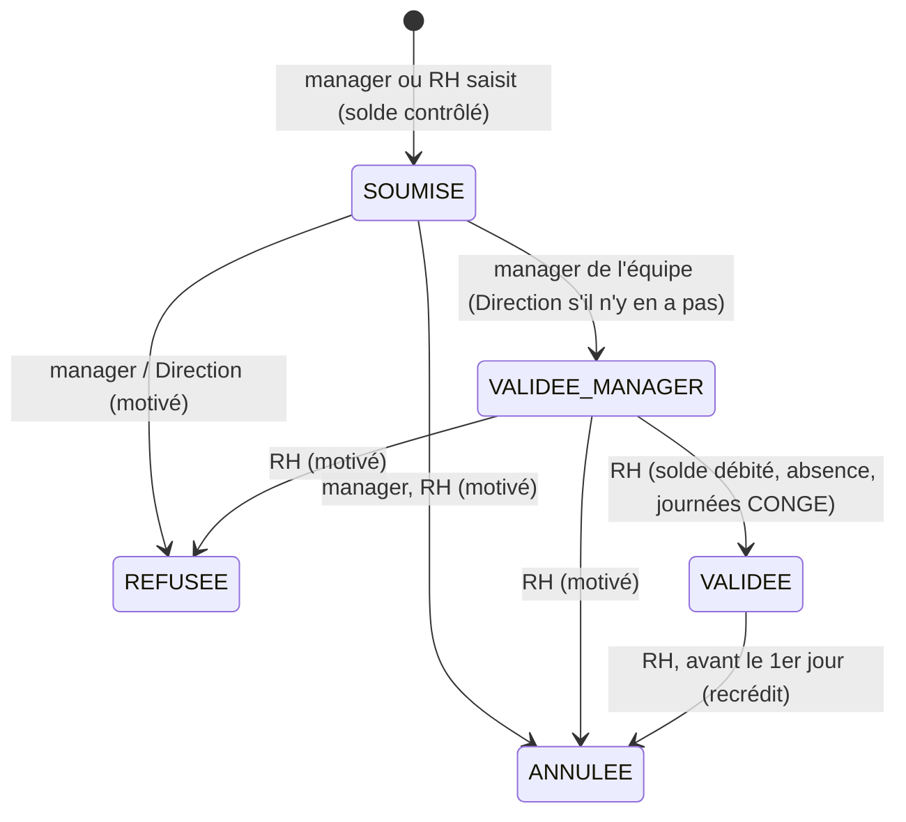

### Règles

| Sujet | Règle |
|---|---|
| Acquisition (D1) | Mois terminé : chaque salarié ayant eu un contrat sur le mois reçoit 2,5 j (paramètre), sans prorata ; une fois par mois (idempotent). |
| Décompte (D2, D3) | Type CALENDAIRE ou OUVRE ; fériés jamais décomptés ; demi-journées début (après-midi) / fin (matin). |
| Solde (D4) | Disponible = acquis − pris − en attente ; jamais négatif. Cache `solde_conge` recalculable (`POST /api/employes/{id}/soldes/recalculer`). |
| Report (D5) | Le solde n'est pas remis à zéro au 1er janvier : il se reporte jusqu'au plafond (90 j, paramètre). Au plafond, le crédit mensuel est réduit à ce qui y ramène. Jamais de perte. |
| Saisie | Salarié ACTIF, contrat actif couvrant la période, ≥ 1 jour décompté, pas de chevauchement (demande ou absence), solde, plafond annuel du type, mois non clôturé. Le manager ne saisit pas un congé déjà commencé ; la RH peut régulariser. |
| Premier niveau (D8) | Manager responsable du département actuel du salarié ; la Direction seulement s'il n'y en a pas (ou si le salarié est ce manager). |
| Validation RH | Même transaction : en attente → pris, absence CONGE, absences injustifiées du calcul remplacées, journées recalculées. |
| Absences | MALADIE / AUTRE saisies (RH, manager) ; INJUSTIFIEE créées par le calcul ; CONGE produites par un congé. `A_JUSTIFIER → JUSTIFIEE` (dépôt du justificatif) ; `→ NON_JUSTIFIEE` (RH) ; annulation (RH, motivée). Délai dépassé signalé, pas de passage automatique. |
| Paie (D10) | Sans-solde et non justifiées = jours retenus ; le reste est payé. |

