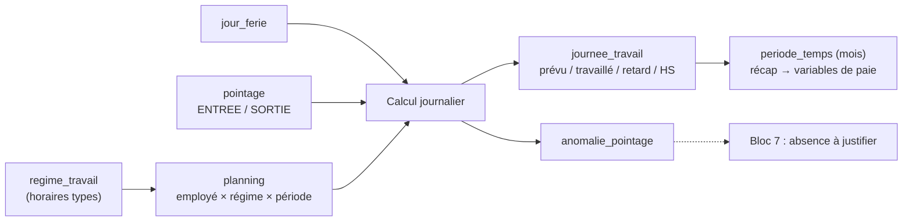

# Todo — Bloc 6 : Temps de travail et pointage

> Source : diapo du cours [`bloc6.jpg`](../cours/bloc6.jpg).
> État : **fait le 08/11/2026** (back, front, tests, données de test). Écarts avec cette todo : [blocs5-7_explications.md](blocs5-7_explications.md#écarts-avec-les-todos-choix-faits-en-codant). Guide : [blocs5-7_guide.md](blocs5-7_guide.md). Prérequis : bloc 5 (statut du salarié, situation professionnelle), contrat actif avec `heures_hebdo` (bloc 4, V11).
> Migration proposée : **V15**.

Ce que demande le cours :
1. Définir horaires, planning et régime de travail.
2. Enregistrer entrées, sorties, retards et heures supplémentaires.
3. Calculer le temps réellement travaillé.
4. Détecter les anomalies de pointage.
5. Les données de temps **alimentent les absences (bloc 7) et les variables de paie**.

## Point de départ

- Rien n'existe pour le temps de travail. Seule donnée utile : `contrat.heures_hebdo` (1 à 60).
- Les salariés **n'ont pas de compte** : ils ne pointent pas dans l'application. Les pointages viennent d'une **saisie RH / manager** ou d'un **import de fichier** (export de badgeuse, CSV). C'est la contrainte la plus structurante du bloc.
- Rôles : RH (paramètres, corrections), MANAGER (son équipe), PAIE (lecture des totaux), ADMIN (lecture).

## Modèle proposé

## À trancher (proposition par défaut si rien n'est décidé)

| # | Question | Proposition par défaut |
|---|---|---|
| D1 | Pointage : une ligne par jour (entrée + sortie) ou un événement par passage ? | **Un événement par passage** (`ENTREE` / `SORTIE` horodatés), comme une badgeuse ; la journée est **calculée** dans `journee_travail`. Gère la pause de midi (4 événements). |
| D2 | Qui saisit ? | RH pour tous ; MANAGER pour son département. Import CSV par la RH (`matricule;horodatage;type`). |
| D3 | Corriger un pointage faux ? | Jamais modifié ni supprimé : le pointage est **annulé** (`annule = true`, motif, qui) et un pointage `source = CORRECTION` est ajouté. |
| D4 | Durée légale et heures supplémentaires | Base : `heures_hebdo` du contrat actif, sinon 40 h (durée légale à Madagascar, **à vérifier**). HS = temps au-delà du prévu de la **semaine**. Taux de majoration en paramètres (proposés : 130 % les 8 premières HS, 150 % au-delà, 140 % dimanche, 150 % férié — **à vérifier dans le Code du travail**). |
| D5 | Les HS doivent-elles être validées ? | Oui : calculées `A_VALIDER`, validées ou refusées par le **manager** du département (motif si refus). Seules les HS validées partent en paie. |
| D6 | Tolérance de retard | 10 minutes (paramètre du régime). Au-delà : retard compté en minutes. |
| D7 | Arrondis | À la minute, sans arrondi au quart d'heure. |
| D8 | Clôture | Une `periode_temps` par mois : `OUVERTE → CLOTUREE` par la RH ; plus aucune saisie ni correction ensuite (`PERIODE_CLOTUREE`). Refusée tant qu'il reste des anomalies ouvertes ou des HS à valider. |
| D9 | Calcul : à la volée ou stocké ? | **Stocké** dans `journee_travail`, recalculé à chaque pointage, correction, changement de planning ou congé validé (bloc 7). Plus simple à lire pour la paie et les tableaux. |
| D10 | Jour sans pointage | Jour travaillé prévu, aucun pointage, pas de congé / absence validé → anomalie `ABSENCE_NON_JUSTIFIEE` → crée une absence « à justifier » au bloc 7. |

## Base (V15)

- [x] `regime_travail` (code UNIQUE, libelle, heures_hebdo, jours_travailles (ex. `LUN,MAR,MER,JEU,VEN`), heure_debut, heure_fin, pause_minutes, tolerance_retard_minutes, actif) ; CHECK heure_fin > heure_debut
- [x] `planning` (employe_id, regime_id, date_debut, date_fin, cree_par, cree_le) : lignes **datées**, pas de chevauchement pour un employé (contrôle service)
- [x] `jour_ferie` (date UNIQUE, libelle) : fériés de Madagascar 2026-2027 en données de test
- [x] `pointage` (employe_id, horodatage, type `ENTREE`/`SORTIE`, source `MANUEL`/`IMPORT`/`CORRECTION`, saisi_par, saisi_le, annule, annule_par, motif_annulation) ; index (employe_id, horodatage)
- [x] `journee_travail` (employe_id, date, minutes_prevues, minutes_travaillees, minutes_retard, minutes_depart_anticipe, minutes_hs, statut `NORMALE`/`ANOMALIE`/`CONGE`/`ABSENCE`/`FERIE`/`REPOS`, periode_id) ; UNIQUE (employe_id, date)
- [x] `anomalie_pointage` (journee_id, type, statut `OUVERTE`/`CORRIGEE`/`JUSTIFIEE`/`IGNOREE`, traitee_par, traitee_le, commentaire)
- [x] `heure_supplementaire` (employe_id, semaine (lundi), minutes, taux, statut `A_VALIDER`/`VALIDEE`/`REFUSEE`, valide_par, valide_le, commentaire) + `historique_heure_supplementaire`
- [x] `periode_temps` (annee, mois, statut `OUVERTE`/`CLOTUREE`, cloturee_par, cloturee_le) ; UNIQUE (annee, mois) + `historique_periode_temps`
- [x] Données de test `scripts/data_bloc6.sql` : 2 régimes (« Bureau 8h-17h » 40 h, « Mi-temps matin » 20 h), plannings des employés actifs, une semaine de pointages avec un retard, un oubli de sortie, des HS, un jour sans pointage

## Modèle / Repository

- [x] Enums `TypePointage`, `SourcePointage`, `StatutJournee`, `TypeAnomalie` (`SORTIE_MANQUANTE`, `ENTREE_MANQUANTE`, `RETARD`, `DEPART_ANTICIPE`, `ABSENCE_NON_JUSTIFIEE`, `POINTAGE_JOUR_NON_TRAVAILLE`, `DOUBLON`), `StatutAnomalie`, `StatutHeureSup`, `StatutPeriode`
- [x] Entités + repositories (package `model/temps`)
- [x] `contextLoads` passe

## Services & règles

- [x] `RegimeTravailService` : CRUD (RH, ADMIN), désactivation au lieu de suppression, `heures_hebdo` cohérent avec horaires × jours (avertissement)
- [x] `PlanningService.affecter` : employé `ACTIF` (`EMPLOYE_NON_ACTIF`), pas de chevauchement (`PLANNING_CHEVAUCHE`), ferme le planning ouvert précédent ; `heures_hebdo` du régime ≤ celles du contrat actif (`REGIME_INCOMPATIBLE_CONTRAT`)
- [x] `PlanningService.prevu(employe, date)` : minutes prévues (0 si jour non travaillé, férié, congé validé du bloc 7)
- [x] `PointageService.saisir` : employé `ACTIF` ; pas dans le futur ; période `OUVERTE` ; MANAGER limité à son département ; puis recalcul de la journée
- [x] `PointageService.importer(fichier)` : CSV `matricule;horodatage;type`, rapport ligne par ligne (importées, rejetées + raison), tout ou rien par ligne
- [x] `PointageService.corriger` (D3) : annule l'ancien avec motif obligatoire, ajoute le nouveau, recalcule
- [x] `CalculTempsService.calculerJournee(employe, date)` : apparier ENTREE/SORTIE dans l'ordre, somme des intervalles, retard = 1re entrée − heure_debut − tolérance, départ anticipé, anomalies (D10, paires incomplètes, doublons à moins de 2 min)
- [x] `CalculTempsService.calculerSemaine` : HS = travaillé − prévu de la semaine si > 0 → `heure_supplementaire` `A_VALIDER` avec le taux (D4)
- [x] `HeureSupWorkflow` : `A_VALIDER → VALIDEE | REFUSEE` (MANAGER du département, RH) ; refus motivé ; historique
- [x] `AnomalieService` : corriger (via un pointage), justifier (lien bloc 7), ignorer (motif) ; une anomalie `ABSENCE_NON_JUSTIFIEE` crée l'absence « à justifier » du bloc 7
- [x] `PeriodeTempsService.cloturer` (D8) : `ANOMALIES_OUVERTES`, `HS_A_VALIDER` ; historique
- [x] `VariablesPaieService.recap(annee, mois)` : par employé — jours travaillés, heures normales, HS par taux (validées), minutes de retard, jours d'absence (bloc 7) ; export CSV pour la PAIE

## API

- [x] `GET/POST /api/regimes-travail`, `PUT /api/regimes-travail/{id}`
- [x] `GET /api/employes/{id}/plannings`, `POST /api/employes/{id}/plannings`
- [x] `GET/POST /api/jours-feries`
- [x] `POST /api/pointages`, `POST /api/pointages/import` (multipart), `POST /api/pointages/{id}/corriger`
- [x] `GET /api/employes/{id}/temps?du=&au=` → journées + pointages + anomalies
- [x] `GET /api/anomalies-pointage?statut=&departementId=`, `POST /api/anomalies-pointage/{id}/ignorer`
- [x] `GET /api/heures-sup?statut=`, `POST /api/heures-sup/{id}/valider`, `/refuser`
- [x] `GET /api/periodes-temps`, `POST /api/periodes-temps/{id}/cloturer`
- [x] `GET /api/variables-paie?annee=&mois=` (RH, PAIE, DIRECTION) + `.csv`
- [x] Mettre à jour `contrat_api.md`

## Sécurité / droits

- [x] RH : tout ; MANAGER : pointages, anomalies et HS de **son** département ; PAIE : variables de paie et lecture des journées ; DIRECTION, ADMIN : lecture
- [x] Règles de rôle aussi dans les services

## Tests

- [x] `CalculTempsServiceTest` (cœur du bloc, cas aux limites) : journée normale, pause midi (4 pointages), retard dans / hors tolérance, sortie manquante, jour férié travaillé, semaine à 45 h → 5 h HS, mi-temps
- [x] `PointageServiceTest` : employé suspendu refusé, futur refusé, période clôturée refusée, correction historisée sans suppression, import avec lignes rejetées
- [x] `PlanningServiceTest` : chevauchement refusé, régime > contrat refusé
- [x] `HeureSupWorkflowTest` et service : manager d'un autre département refusé, refus sans motif refusé
- [x] `PeriodeTempsServiceTest` : clôture refusée avec anomalies ouvertes

## Front Vue.js

- [x] Paramètres (RH, ADMIN) : régimes de travail, jours fériés
- [x] Dossier salarié, onglet **Temps** : planning en cours, calendrier du mois (couleur par statut de journée), détail d'une journée (pointages, corrections)
- [x] Saisie d'un pointage et import CSV avec rapport d'import
- [x] « Anomalies de pointage » (RH, manager) : tableau filtrable, actions corriger / ignorer
- [x] « Heures supplémentaires à valider » (manager) dans « À faire » avec compteur
- [x] « Périodes » : clôture du mois ; « Variables de paie » : tableau + export CSV (PAIE)

## Démo

- [x] Scénario : régime « Bureau » → planning d'un salarié → import d'une semaine → retard et sortie manquante détectés → correction motivée → semaine à 45 h → HS validée par le manager → récap du mois → clôture → export paie
- [x] Contre-tests : pointage sur salarié suspendu, saisie après clôture, manager d'un autre département, clôture avec anomalie ouverte
- [x] Vérifier en base : pointages annulés conservés, `journee_travail` recalculée, historiques des HS et de la période

## Branchements avec les blocs 5 et 7

- Bloc 5 : statut `ACTIF` obligatoire ; contrat actif → `heures_hebdo` ; département → manager responsable.
- Bloc 7 : un congé ou une absence validée met la journée en `CONGE` / `ABSENCE` (minutes prévues = 0, pas d'anomalie) ; une anomalie `ABSENCE_NON_JUSTIFIEE` crée une absence à justifier ; les jours d'absence remontent dans les variables de paie.
