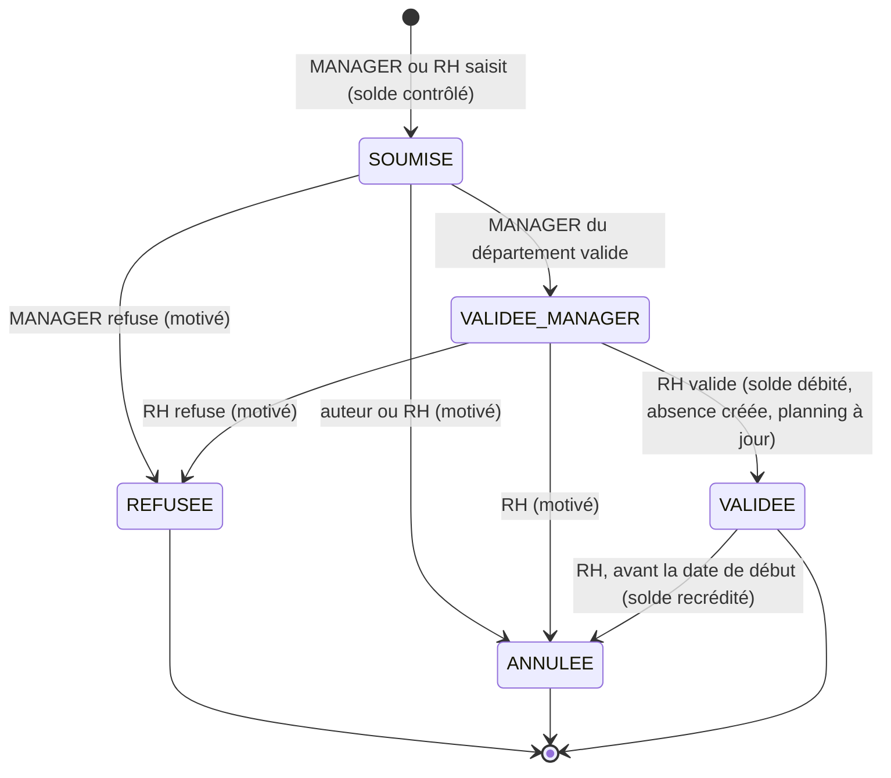

# Todo — Bloc 7 : Congés et absences

> Source : diapo du cours [`bloc7.jpg`](../cours/bloc7.jpg).
> État : **fait le 08/11/2026** avec les propositions par défaut (D5 expliqué dans [blocs5-7_explications.md](blocs5-7_explications.md)). Guide : [blocs5-7_guide.md](blocs5-7_guide.md). Prérequis : bloc 5 (statut du salarié), bloc 6 (planning, journées, variables de paie).
> Migration proposée : **V16**.

Ce que demande le cours :
1. Demande de congé → **contrôle du solde** → **validation manager / RH**.
2. Gérer droits, soldes, types de congés, absences et justificatifs.
3. Contrôler les **chevauchements** et la disponibilité du solde.
4. Mettre à jour le **planning** et les **variables de paie**.
5. Objets imposés : **TypeConge, DroitConge, SoldeConge, DemandeConge, Absence**.

Contrainte du projet : les salariés **n'ont pas de compte**. La demande est donc **saisie pour le salarié** par son manager ou par la RH (à partir d'une demande écrite), puis validée.

## Workflow d'une demande de congé (proposé)

Si c'est la RH qui saisit, l'étape manager reste obligatoire (le cours dit « manager / RH »). Si le manager du département est lui-même le demandeur : à trancher (D8).

## À trancher (proposition par défaut si rien n'est décidé)

| # | Question | Proposition par défaut |
|---|---|---|
| D1 | Acquisition du congé payé | **2,5 jours par mois** de travail effectif (30 jours / an, Code du travail malgache — **à vérifier**), crédités le 1er du mois suivant par un traitement mensuel (bouton RH au MVP, pas de tâche planifiée). |
| D2 | Jours décomptés : ouvrables, ouvrés ou calendaires ? | **Calendaires** pour le congé payé (règle malgache usuelle — **à vérifier**) ; ouvrés pour les permissions. Le type de congé porte la règle (`mode_decompte`). Fériés jamais décomptés. |
| D3 | Demi-journées | Oui : `demi_journee_debut` / `demi_journee_fin` (matin / après-midi), décompte par 0,5. |
| D4 | Solde négatif | Interdit (`SOLDE_INSUFFISANT`). Le solde « disponible » = acquis − pris − **en attente** (demandes SOUMISE et VALIDEE_MANAGER). |
| D5 | Report d'une année sur l'autre | Le solde est **par employé et par type** (pas par année) au MVP ; plafond de cumul en paramètre (ex. 90 jours), sans perte automatique. |
| D6 | Types de congé (données de départ) | `CONGE_PAYE` (décompte le solde), `PERMISSION_EXCEPTIONNELLE` (10 j / an, mariage, décès…), `MALADIE` (justificatif obligatoire, pas de solde), `MATERNITE` (14 semaines, justificatif), `PATERNITE`, `SANS_SOLDE` (non payé). Durées **à vérifier**. |
| D7 | Absence ≠ congé ? | Oui : un **congé** est demandé à l'avance et validé ; une **absence** est constatée (maladie, absence injustifiée venue du pointage, retard long). Un congé validé produit aussi une `absence` (source `CONGE`) pour avoir une seule table pour le planning et la paie. |
| D8 | Demande d'un manager pour lui-même | Saisie par la RH, validation directe par la **Direction** au lieu du manager. |
| D9 | Justificatif | Document `JUSTIFICATIF_ABSENCE` (bloc 5) rattaché à l'absence ; obligatoire selon le type ; délai 48 h (paramètre), sinon l'absence passe `NON_JUSTIFIEE`. |
| D10 | Effets paie | `SANS_SOLDE` et `NON_JUSTIFIEE` → jours retenus sur le salaire ; les autres sont payés. Remontés dans `VariablesPaieService` (bloc 6). |

## Base (V16)

- [x] `type_conge` (code UNIQUE, libelle, decompte_solde, mode_decompte `CALENDAIRE`/`OUVRE`, justificatif_obligatoire, paye, plafond_jours, actif)
- [x] `droit_conge` (employe_id, type_conge_id, jours (peut être négatif pour un ajustement), origine `ACQUISITION`/`AJUSTEMENT`/`REPRISE`, periode (mois), motif, cree_par, cree_le) : **mouvements** de crédit, jamais modifiés ; UNIQUE (employe_id, type_conge_id, periode) pour `ACQUISITION`
- [x] `solde_conge` (employe_id, type_conge_id, acquis, pris, en_attente, maj_le) ; UNIQUE (employe_id, type_conge_id) ; CHECK acquis − pris − en_attente ≥ 0 — **cache recalculable** à partir des mouvements et des demandes
- [x] `demande_conge` (employe_id, type_conge_id, date_debut, date_fin, demi_journee_debut, demi_journee_fin, nombre_jours, motif, statut, saisie_par, cree_le) ; CHECK date_fin ≥ date_debut, nombre_jours > 0
- [x] `historique_demande_conge` (ancien_statut, nouveau_statut, utilisateur_id, date_action, commentaire)
- [x] `absence` (employe_id, type `CONGE`/`MALADIE`/`INJUSTIFIEE`/`AUTRE`, date_debut, date_fin, nombre_jours, demande_conge_id NULL, anomalie_id NULL (bloc 6), statut `A_JUSTIFIER`/`JUSTIFIEE`/`NON_JUSTIFIEE`/`ANNULEE`, saisie_par) + `historique_absence`
- [x] Données de test `scripts/data_bloc7.sql` : les 6 types de D6, droits acquis pour les employés actifs (quelques mois), une demande à chaque statut, une absence maladie justifiée, une absence injustifiée issue du pointage

## Modèle / Repository

- [x] Enums `ModeDecompte`, `OrigineDroit`, `StatutDemandeConge`, `TypeAbsence`, `StatutAbsence`
- [x] `TypeConge`, `DroitConge`, `SoldeConge`, `DemandeConge`, `HistoriqueDemandeConge`, `Absence`, `HistoriqueAbsence` + repositories (package `model/conge`)
- [x] Requête de chevauchement : demandes non `REFUSEE`/`ANNULEE` et absences non `ANNULEE` du même employé dont la période croise `[debut, fin]`
- [x] `contextLoads` passe

## Services & règles

- [x] `TypeCongeService` : CRUD (RH, ADMIN), désactivation, pas de suppression
- [x] `DroitCongeService.acquerirMois(annee, mois)` (RH) : 2,5 j par employé ACTIF ayant un contrat actif sur le mois (prorata si embauche en cours de mois — à trancher), idempotent (UNIQUE) ; `ajuster` avec motif obligatoire
- [x] `CalculJoursService.decompter(type, debut, fin, demiJournees)` : calendaires / ouvrés, fériés exclus (`jour_ferie`, bloc 6), demi-journées
- [x] `DemandeCongeWorkflow` (statut × rôle, voir le diagramme)
- [x] `DemandeCongeService.creer` : employé `ACTIF` (`EMPLOYE_NON_ACTIF`), contrat actif couvrant la période (`HORS_CONTRAT`), date de début ≥ aujourd'hui sauf maladie (`DATE_PASSEE`), **chevauchement** (`CONGE_CHEVAUCHE`), **solde disponible** (`SOLDE_INSUFFISANT`) ; met à jour `en_attente` ; manager limité à son département ; historique `null → SOUMISE`
- [x] `DemandeCongeService.changerStatut` : refus / annulation motivés (`REFUS_NON_MOTIVE`) ; à la validation RH, **dans la même transaction** : solde `en_attente → pris`, création de l'`absence` (source congé), recalcul des `journee_travail` de la période (bloc 6 : statut `CONGE`, anomalies levées) ; à l'annulation d'un congé validé : recrédit, absence `ANNULEE`, recalcul ; refusée si la période est clôturée (`PERIODE_CLOTUREE`)
- [x] `AbsenceService` : saisie d'une absence constatée (RH, manager), création automatique depuis une anomalie `ABSENCE_NON_JUSTIFIEE` (bloc 6), dépôt du justificatif → `JUSTIFIEE`, passage `NON_JUSTIFIEE` après le délai (action RH au MVP)
- [x] Variables de paie (bloc 6) : jours de congé payé, jours sans solde, jours d'absence non justifiée, jours maladie
- [x] `SoldeCongeService.recalculer(employe)` : reconstruit le cache depuis les mouvements et les demandes (outil de contrôle, test de cohérence)

## API

- [x] `GET/POST /api/types-conge`, `PUT /api/types-conge/{id}`
- [x] `GET /api/employes/{id}/soldes` → soldes par type (acquis, pris, en attente, disponible)
- [x] `GET /api/employes/{id}/droits`, `POST /api/employes/{id}/droits` (ajustement), `POST /api/droits-conge/acquisition` `{annee, mois}`
- [x] `POST /api/demandes-conge`, `GET /api/demandes-conge?statut=&employeId=&departementId=`, `GET /api/demandes-conge/{id}` (+ historique, solde au moment de la demande)
- [x] `POST /api/demandes-conge/{id}/valider`, `/refuser`, `/annuler` (`CommentaireRequest`)
- [x] `GET /api/demandes-conge/simulation?employeId=&typeId=&du=&au=` → nombre de jours, solde après, chevauchements (aide à la saisie)
- [x] `GET/POST /api/absences`, `POST /api/absences/{id}/justifier` (multipart ou `documentId`), `/non-justifiee`, `/annuler`
- [x] `GET /api/calendrier-equipe?departementId=&mois=` → qui est absent quand
- [x] Mettre à jour `contrat_api.md`

## Sécurité / droits

- [x] MANAGER : saisit et valide (1er niveau) pour **son** département ; RH : tout, 2e niveau ; DIRECTION : valide les demandes des managers (D8) ; PAIE : lecture des soldes et des absences ; ADMIN : lecture
- [x] Règles aussi dans les services (le manager ne valide pas une demande d'un autre département : `ACCES_REFUSE`)

## Tests

- [x] `CalculJoursServiceTest` : calendaires vs ouvrés, férié exclu, demi-journées, période sur deux mois
- [x] `DemandeCongeWorkflowTest`
- [x] `DemandeCongeServiceTest` : solde insuffisant (en comptant l'en-attente), chevauchement avec une demande et avec une absence, employé suspendu, hors contrat, refus non motivé, validation → solde débité + absence + journées en `CONGE`, annulation → recrédit, période clôturée
- [x] `DroitCongeServiceTest` : acquisition idempotente, ajustement sans motif refusé
- [x] `AbsenceServiceTest` : absence issue d'une anomalie, justification, maladie sans justificatif
- [x] Test de cohérence : `recalculer` redonne le même solde que le cache

## Front Vue.js

- [x] Dossier salarié, onglet **Congés** : soldes par type, demandes, absences
- [x] Formulaire « Demande de congé » (pour un salarié) avec **simulation** en direct : jours décomptés, solde après, chevauchement signalé
- [x] « Congés à valider » dans « À faire » (manager puis RH) avec compteurs ; Dialogue de refus avec motif
- [x] Fiche d'une demande : période, jours, solde, historique (Chronologie)
- [x] « Absences » (RH) : à justifier, dépôt du justificatif, non justifiées
- [x] Calendrier d'équipe du mois (manager)
- [x] Paramètres : types de congé ; bouton « Créditer les congés du mois » (RH)

## Démo

- [x] Scénario : crédit des congés d'octobre → le manager saisit 5 jours pour un salarié (simulation OK) → validation manager → validation RH → solde débité, journées en `CONGE`, plus d'anomalie au pointage → annulation avant départ → recrédit
- [x] Contre-tests : solde insuffisant, chevauchement, salarié suspendu, manager d'un autre département, refus sans motif
- [x] Absence : jour sans pointage (bloc 6) → absence à justifier → certificat déposé → justifiée ; une autre reste non justifiée → retenue dans les variables de paie
- [x] Vérifier en base : `historique_demande_conge`, `droit_conge`, cohérence `solde_conge`, `absence.demande_conge_id`

## Branchements avec les blocs 5 et 6

- Bloc 5 : statut du salarié, contrat actif, type de document `JUSTIFICATIF_ABSENCE`.
- Bloc 6 : `jour_ferie`, recalcul de `journee_travail`, anomalie → absence, `periode_temps` clôturée bloque les changements, `VariablesPaieService` reçoit les jours d'absence.
