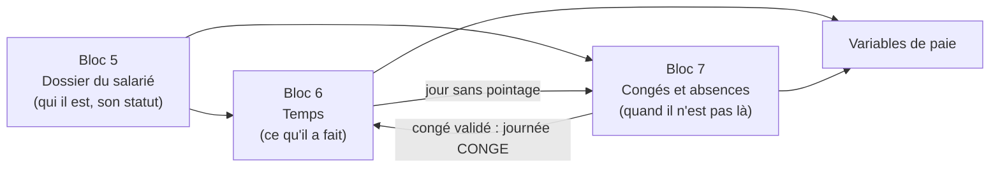

# Blocs 5 à 7 : ce que veut dire chaque ajout

> Une page pour savoir **à quoi sert** chaque morceau ajouté le 08/11/2026 (logique, base, back, front).
> Pour **s'en servir** pas à pas : [blocs5-7_guide.md](blocs5-7_guide.md). Le détail des règles : [Conception.md](Conception.md) § blocs 5 à 7 ; les routes : [contrat_api.md](contrat_api.md) § 9 à 11.

## L'idée générale

- Le **dossier** est la référence : un salarié SUSPENDU ou SORTI ne peut plus être pointé ni recevoir de congé.
- Le salarié **n'a pas de compte** : la RH ou son manager saisit tout pour lui (pointages, demandes, absences).
- Rien n'est supprimé : on **annule** (avec un motif) et on **historise**.

## Bloc 5 — dossier administratif

| Ajout | Ce que c'est | Où |
|---|---|---|
| Nouvelles colonnes de `employe` | Sexe, CIN, adresse, famille, contact d'urgence, date et motif de sortie. **Toutes facultatives** : rien d'autre ne les exige. | V14, `Employe` |
| Contrôle strict / souple | En mode démo, CIN « 123 », téléphone libre, âge non vérifié, date d'expiration facultative : **rien ne bloque les essais**. Avec la sécurité active (ou `SIRH_CONTROLES_STRICTS=true`), tout est vérifié. L'unicité de la CIN et de l'e-mail est toujours vérifiée. | `ReglesDossier`, `application.yml` |
| Historique des modifications | Chaque champ changé = une ligne (avant, après, motif, qui, quand). | `historique_modification_employe`, `EmployeService.modifier` |
| Statuts du salarié | Suspendre, réintégrer, faire sortir (motif obligatoire). La sortie ferme l'affectation, libère le poste, ferme le planning, annule les congés en cours. | `EmployeWorkflow`, `EmployeService`, `SuiteSortieSalarie` |
| Situation professionnelle | Poste, département, contrat actif, salaire courant, ancienneté : **calculés**, pas stockés. | `SituationProfessionnelleService` |
| Carrière | Frise calculée à partir des contrats, avenants, affectations et statuts. | `CarriereService` |
| Validité des pièces | Expiration, numéro ; une nouvelle CIN « remplace » l'ancienne (gardée). État : valide, expire bientôt, expirée, remplacée. | `document` (V14), `DocumentService`, `Document.etat` |
| Habilitations | Qui voit quoi : RH tout ; Direction et Admin lisent ; Paie lit sans les pièces sauf le RIB ; manager son équipe sans salaire. | `HabilitationsDossier`, `EquipeManager` |
| **Journal d'audit** | Qui a **consulté** un dossier ou un salaire, **téléchargé** une pièce, **modifié**, **exporté**, ou s'est vu **refuser** l'accès. Ajout seul : un déclencheur SQL interdit de le modifier. | `journal_audit`, `JournalAuditService` |

Front : liste du personnel enrichie (poste, contrat, « incomplet ») ; dossier en **onglets** (Identité, Situation et contrats, Carrière, Documents, Temps, Congés et absences, Historique) ; boutons Modifier / Suspendre / Réintégrer / Faire sortir ; écrans « Pièces à renouveler » (RH) et « Journal d'audit » (Admin, Direction).

## Bloc 6 — temps de travail

| Ajout | Ce que c'est | Où |
|---|---|---|
| Paramètres RH | Durée légale, taux et palier des heures sup., tolérance, arrondi, règles des congés : **la RH les change** sans toucher au code (D4, D6), chaque changement historisé et tracé. | `parametre` (V15), `ParametreService`, écran « Paramètres RH » |
| Régime de travail | Horaires types (jours, heures, pause, tolérance). | `regime_travail`, `RegimeTravailService` |
| Planning | Quel régime pour quel salarié, à partir de quand. Sans planning, pas de pointage. | `planning`, `PlanningService` |
| Pointage | Un passage ENTREE ou SORTIE, saisi ou importé (CSV). Jamais modifié : annulé, puis corrigé par un pointage CORRECTION. | `pointage`, `PointageService` |
| Calcul d'une journée | Apparie les pointages, calcule prévu / travaillé / retard / départ anticipé, détecte les anomalies. Code **sans base**, testé seul. | `CalculJournee` |
| Journée stockée | Le résultat est rangé dans `journee_travail`, recalculé à chaque écriture. | `CalculTempsService` |
| Anomalies | Retard, sortie manquante, doublon… Corrigées toutes seules par un bon pointage ; sinon justifiées ou ignorées avec un motif. Un jour sans pointage devient une **absence à justifier** (bloc 7). | `anomalie_pointage`, `AnomalieService` |
| Heures supplémentaires | Par semaine : travaillé − prévu, ventilées par taux, à valider par le manager. | `heure_supplementaire`, `HeureSupService` |
| Mois (période) | Clôturé par la RH quand tout est traité : ensuite plus rien ne bouge. | `periode_temps`, `ControlePeriode`, `PeriodeTempsService` |
| Variables de paie | Ce que la paie reçoit : temps, retards, HS validées, congés, absences, jours retenus ; export CSV. | `VariablesPaieService` |

Front : « Pointage » (saisie, import, recalcul), onglet « Temps » du dossier (journées du mois, pointages, corriger / annuler), « Anomalies de pointage », « Heures supplémentaires », « Mois et variables de paie », « Paramètres RH ».

## Bloc 7 — congés et absences

| Ajout | Ce que c'est | Où |
|---|---|---|
| `TypeConge` | Règles d'un type : consomme le solde ? calendaire ou ouvré ? justificatif ? payé ? plafond par an ? | `type_conge` (V16) |
| `DroitConge` | Mouvements de droits : 2,5 j par mois (bouton « Créditer » de la RH), ajustements motivés. Jamais modifiés. | `droit_conge`, `DroitCongeService` |
| `SoldeConge` | Acquis, pris, en attente, disponible. C'est un **cache** recalculable. | `solde_conge`, `SoldeCongeService` |
| `DemandeConge` | Saisie pour le salarié → solde contrôlé → manager → RH. Simulation avant saisie. | `demande_conge`, `DemandeCongeWorkflow`, `DemandeCongeService` |
| `Absence` | Ce qui couvre une journée : congé validé, maladie, jour sans pointage… À justifier par une pièce. | `absence`, `AbsenceService`, `AbsenceAuto` |
| Calendrier d'équipe | Qui est absent quand, sur un mois. | `CalendrierService` |

Front : « Congés » (à valider / toutes, nouvelle demande avec simulation), fiche d'une demande (valider, refuser, annuler, historique), « Absences » (justifier avec un fichier, non justifiée, annuler), onglet « Congés et absences » du dossier (soldes, droits, ajustement), « Calendrier d'équipe ».

### D5 (bloc 7) : c'est quoi le « report » ?

Question : un salarié qui n'a pas pris tous ses congés en 2026, les garde-t-il en 2027 ?
**Réponse retenue : oui.** Le solde n'est pas remis à zéro au 1er janvier ; il continue d'année en année, mais il ne peut pas dépasser un **plafond** (paramètre `PLAFOND_CONGE_PAYE`, 90 jours par défaut). Arrivé au plafond, le crédit mensuel n'ajoute plus que ce qui y ramène ; on ne perd jamais un jour déjà acquis. La RH change le plafond dans « Paramètres RH ». Exemple : Jean a un ajustement « +3 j, report de l'an dernier » dans les données de test.

## Écarts avec les todos (choix faits en codant)

- Pièce d'identité : date d'expiration **facultative** (la CIN malgache n'expire pas) ; obligatoire seulement pour certificat médical, permis, titre de séjour, et en contrôle strict.
- Liste du personnel : le manager voit toujours tous les noms (le bloc 1 en a besoin pour un remplacement) mais n'ouvre que les dossiers de son équipe.
- `parametre` : table ajoutée (non prévue) pour que la RH règle D4 et D6.
- Anomalie : rattachée à l'employé et au jour (pas à la ligne de journée, qui est recalculée) ; statut `TRANSFEREE` ajouté (jour sans pointage passé aux absences).
- Heures sup. : statut `ANNULEE` ajouté (plus d'heures sup. au recalcul).
- Acquisition : pas de prorata ; plafond appliqué au crédit.
- Absence « non justifiée » : décision de la RH (pas de passage automatique au bout de 48 h ; le délai est seulement signalé).
- Migrations V14 à V16 appliquées avant V13 (réservée à todofix) : `spring.flyway.out-of-order: true`.
